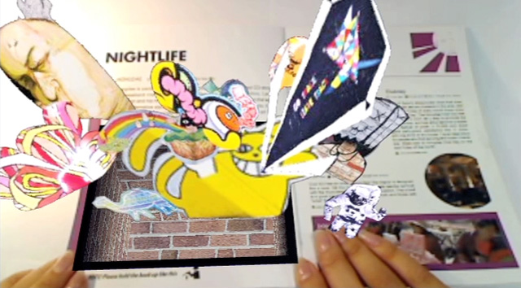
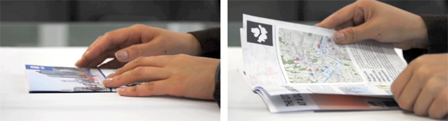
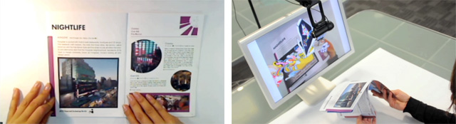
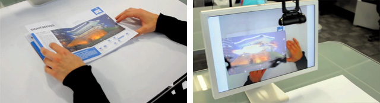
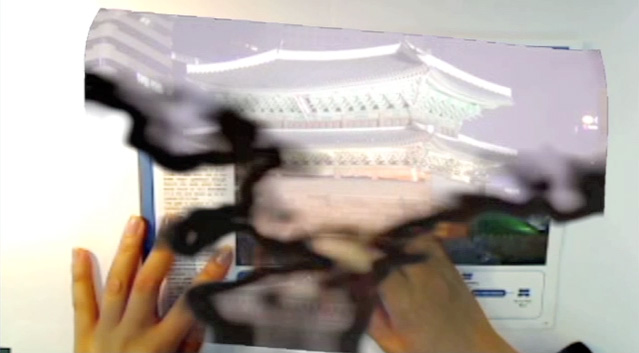
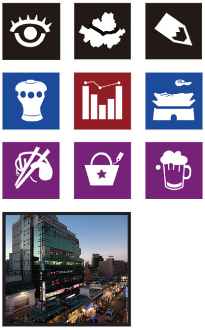

Technical support and programming for AR Planet by Youjin Yoon. The implementation used Flash AS3 and FLARToolKit 2.5.4 with visual markers.

- [Video](https://www.youtube.com/watch?v=_7r88Q49MEU)
