Production assistance for Romy Achituv’s installation. The existing archive documents the work and its fabrication process.

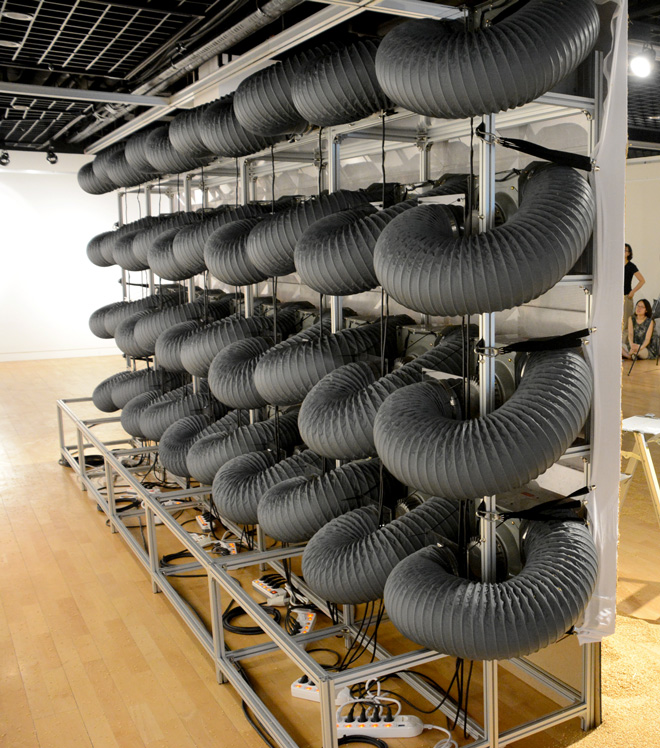

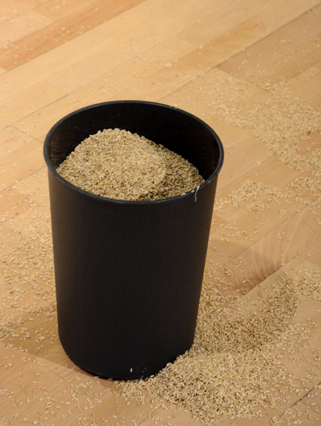

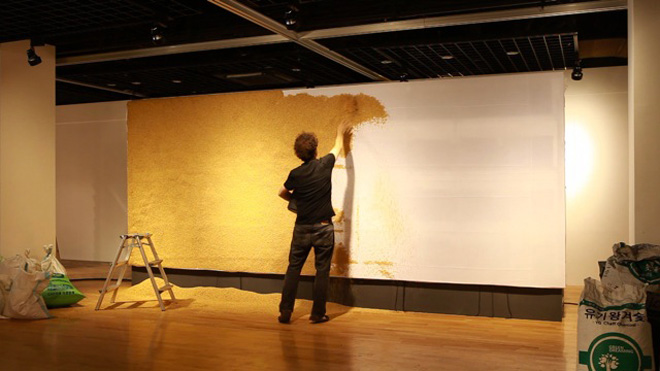

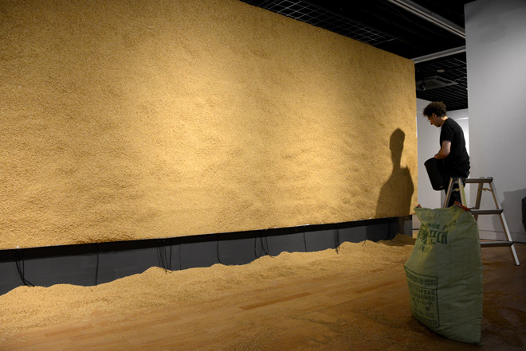

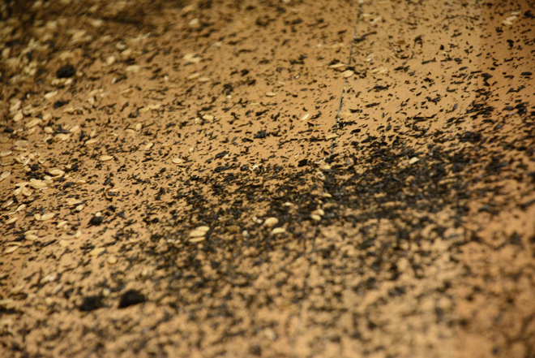

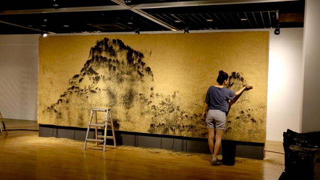

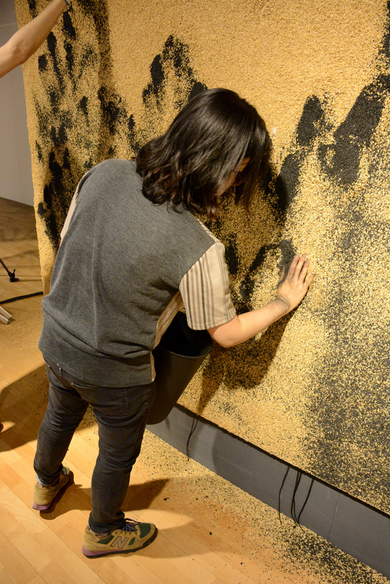

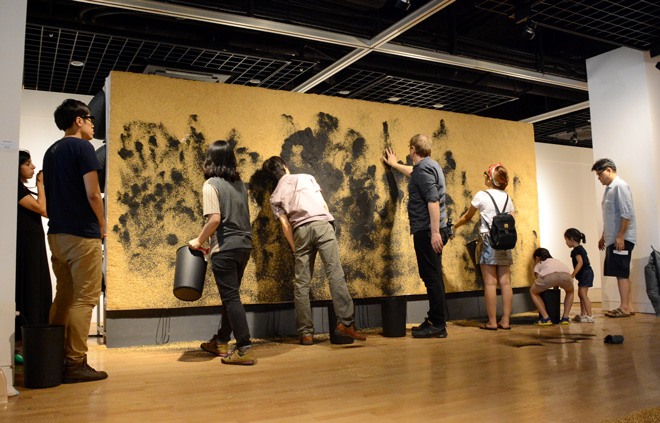

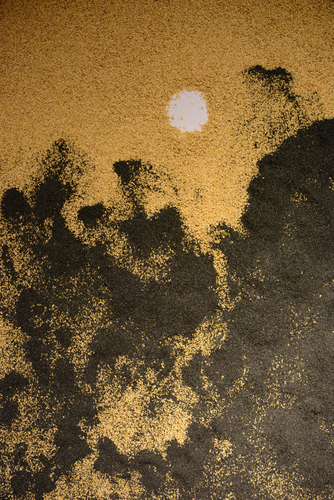

<iframe width="1120" height="630" src="https://player.vimeo.com/video/83819049" title="Ash and Hush — archived video 1" loading="lazy" allow="autoplay; fullscreen; picture-in-picture" allowfullscreen></iframe>

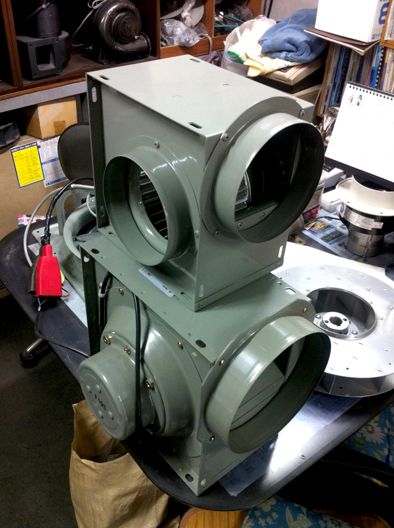

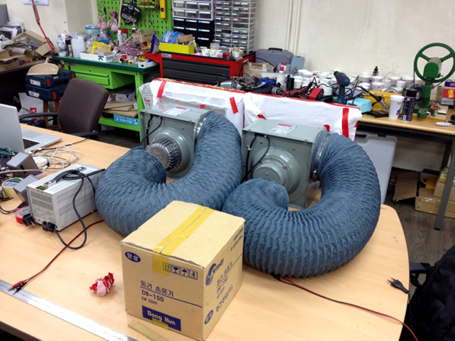

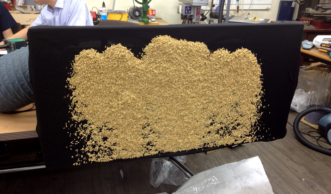

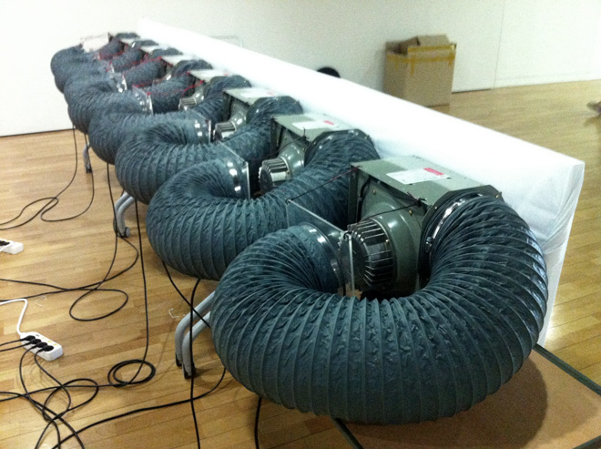

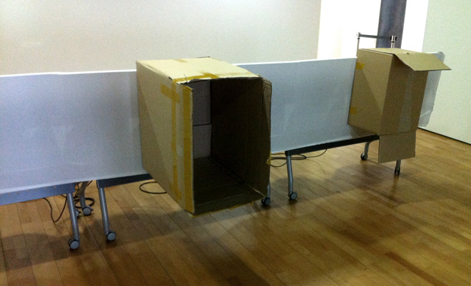

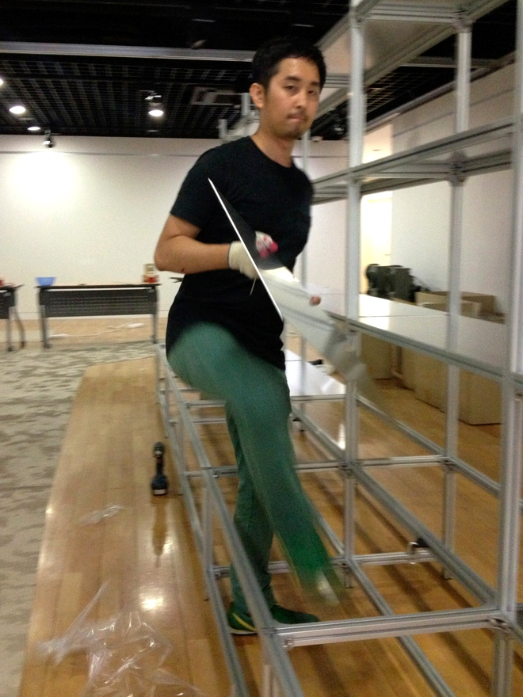

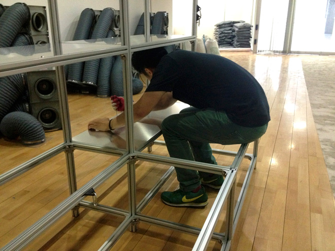

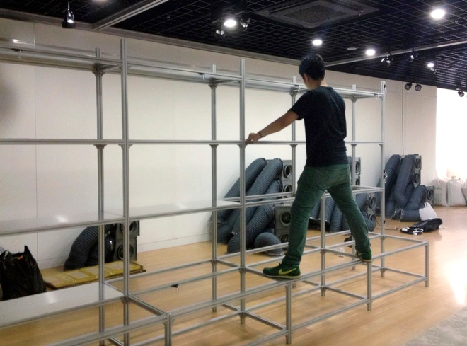

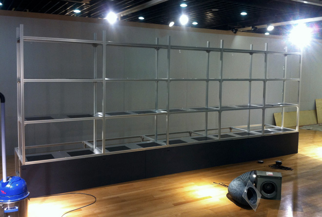

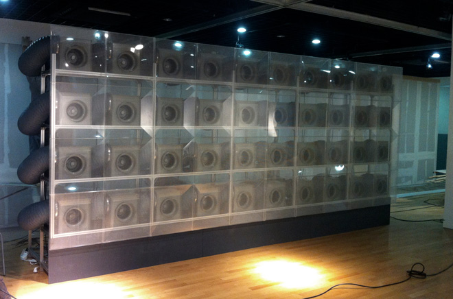
