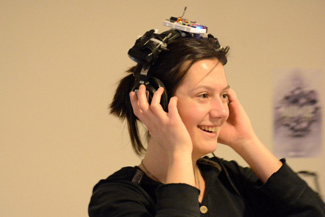
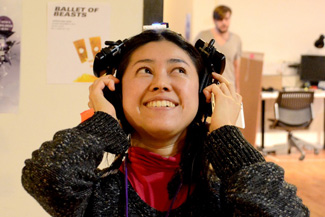
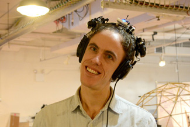
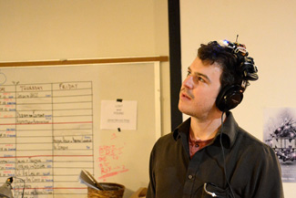
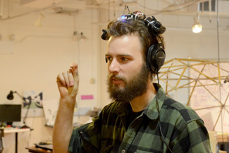

Augmented Soundscape Headphones (ASH) combine binaural microphones, movement sensing, and audio processing. The headphones amplify environmental sound and modify it in response to the wearer’s head movements and gestures.

An MPU-6050 sensor sends motion data through an Arduino Pro Micro and XBee modules. A Processing sketch organizes the data into gestures, which control audio filters in Ableton Live. Development records include microphone tests, sensor visualization, and user testing.

