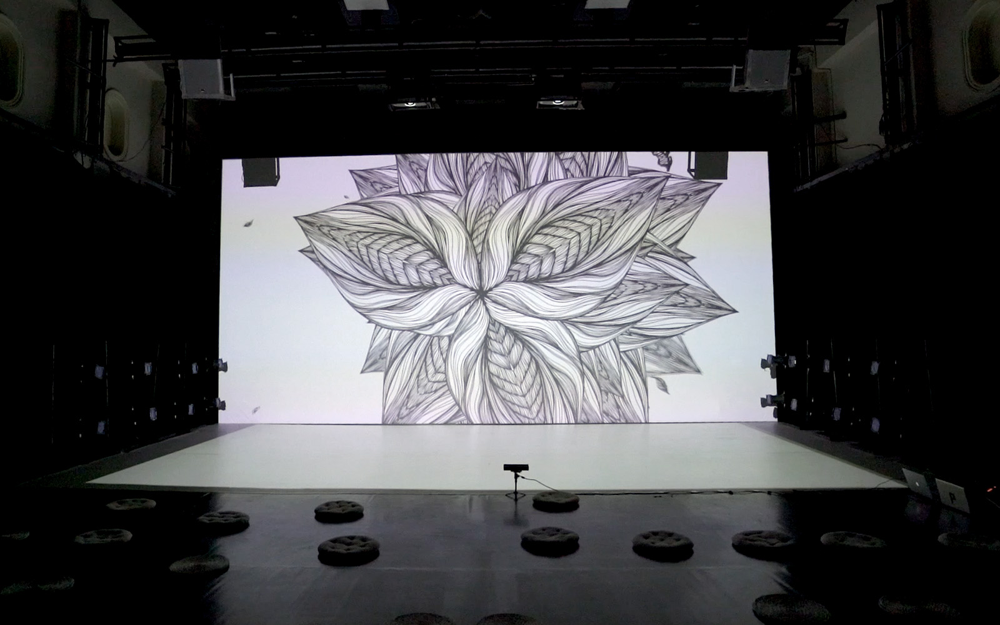
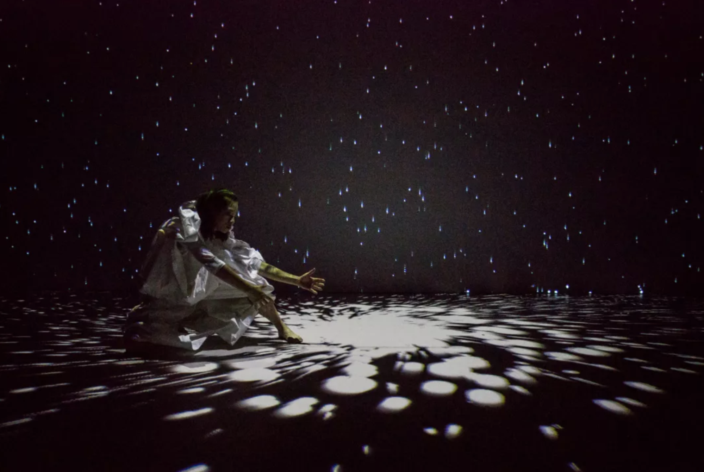
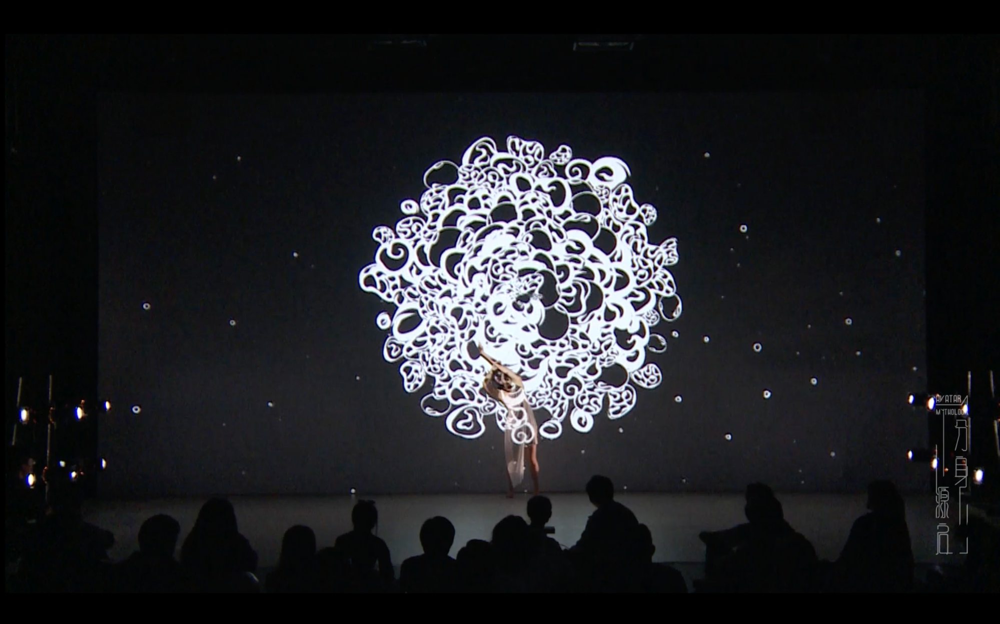
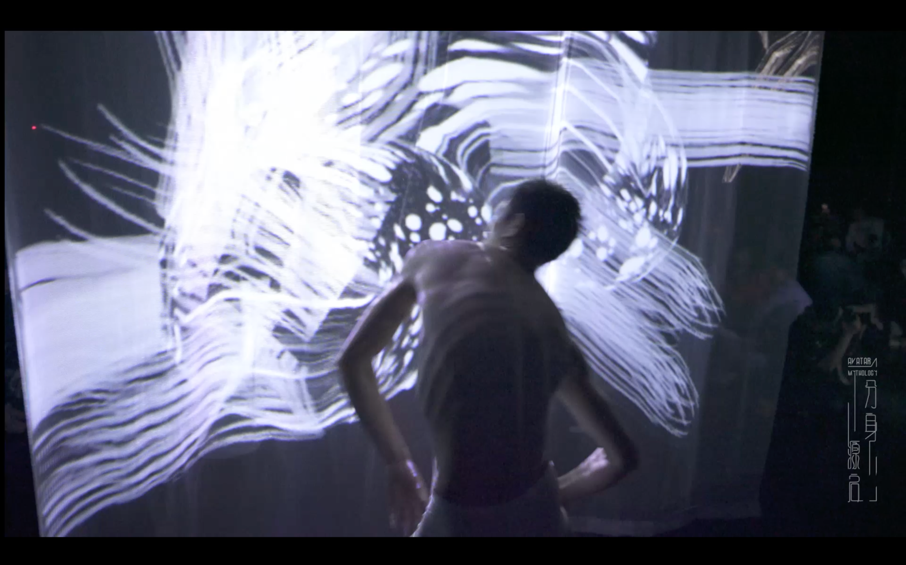
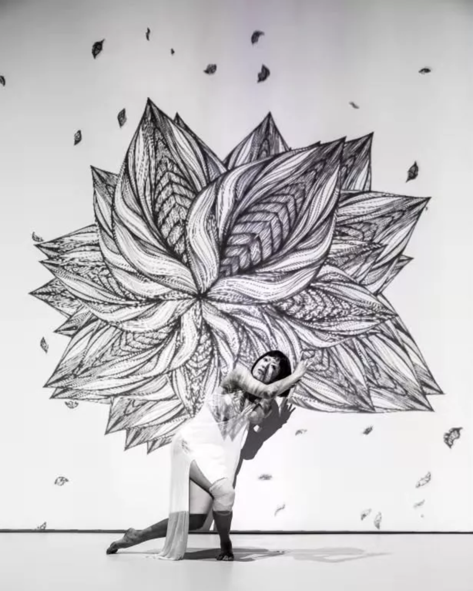
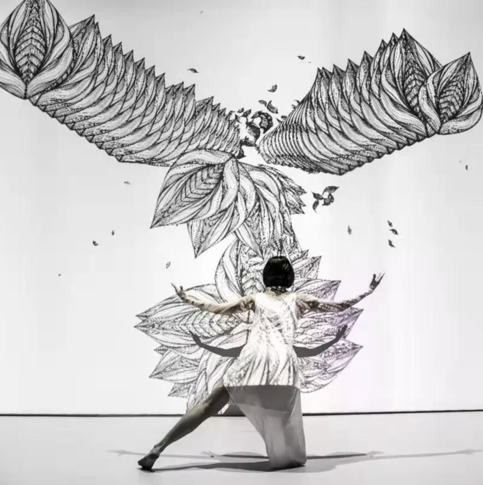
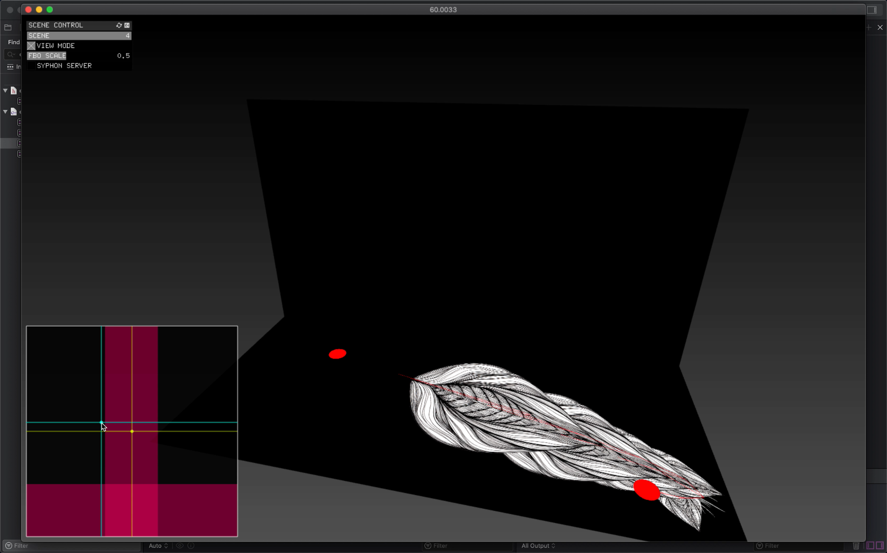
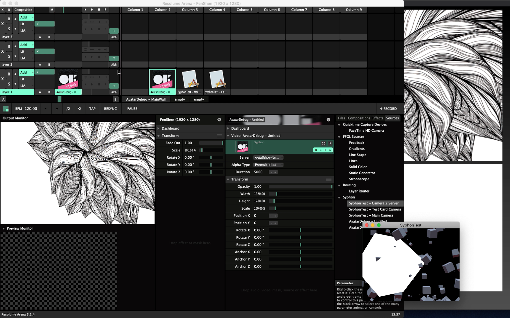
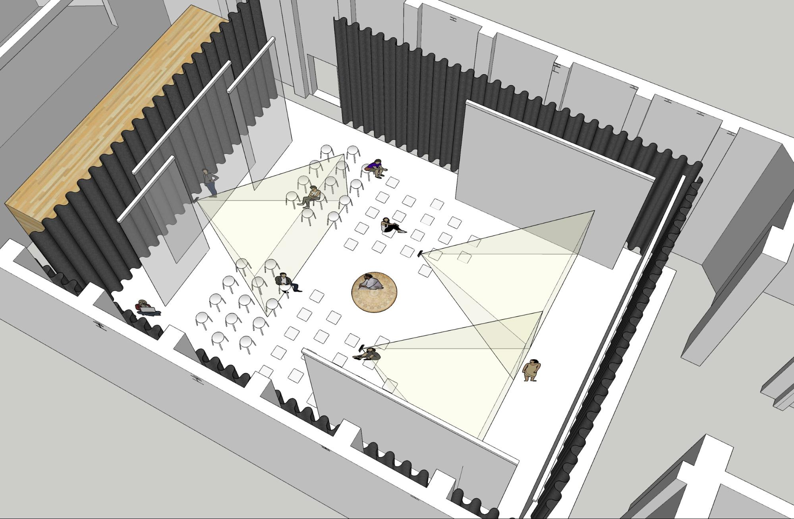
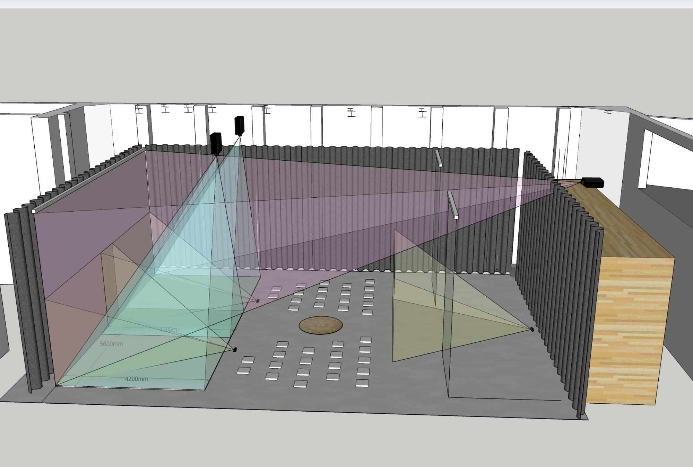

A new-media dance performance presented in the 2019 China Shanghai International Arts Festival’s Rising Artists’ Works program. The work draws on Shan Hai Jing and uses motion-tracked figures, live visuals, sound, and projection mapping.

The performance combines choreography with digital figures that respond to the dancers’ movements. Media-art work included creature design, software and interface development, live visual control, and stage-layout planning.

<iframe loading="lazy" title="Avatar · Mythology — video" width="800" height="450" src="https://www.youtube.com/embed/Wl_59HQjO3M" frameborder="0" allowfullscreen></iframe>

<iframe loading="lazy" title="Avatar · Mythology — video" width="800" height="450" src="https://www.youtube.com/embed/mPm63bvD778" frameborder="0" allowfullscreen></iframe>

## Concept

Digital creatures were designed with different proportions and movement behavior, such as extended arms, short legs, and bird-like forms. The dancers rehearsed responses to these figures.

Live-drawn environmental visuals and real-time media control allowed the performers and media artists to adjust material during the performance.

## Development

Algorithmic visuals were developed in openFrameworks with a custom control interface. Later sequences used 3D models rigged in Unity and controlled through OSC from an iPad.

Resolume Arena was used for projection mapping and media cues. Stage layouts and sensing areas were planned through 3D mock-ups. The system combined motion capture, semi-transparent screens, real-time graphics, and sound.

An opening scene that implies accumulated energy from the environment. 

A scene that represents the birth of life and the unknown. 

A stage setup at the back where dancers and avatars interact. Various creatures were projected on the translucent screen. 

**Real-time Motion Tracking**

The creature first appears as a plant-like form. 

The creature evolves into a bird-like figure and mimics the dancers&#x27; movements. 

**Custom Interface**

Custom control interface using Apple Trackpad gestures. 

**Projection Mapping Interface**

Resolume Arena interface for media cues, real-time control, and projection mapping. 

**Stage Mock-ups**

3D mock-ups of the stage, projection layout, and sensing areas. 

## Credits

Producer: Zhang Yinan

Director: Jung Hyun Moon

Art Director: Li Yuejuan

Choreographer &amp; Dancer: Chiayi Jess Seetoo, Yu Chien Cheng, Zheng Lingmin

Media Art: Jung Hyun Moon, Zhang Yinan, Zhou Xing, Cao Yanbin, Bin Xue

Music Composition and Sound Design: Jung Min Moon

Music Performance: Paul Yip

Stage Manager December Yang

Costume: Sophia Zhao

Lighting: Li Mingfang

Project Assistant: Liu Zhao

## Press

Coverage includes [WeChat Article](https://mp.weixin.qq.com/s/QxN-pPdxsOR80YqNevGGOg), [CGTN Interview](https://news.cgtn.com/news/2019-10-23/New-media-drama-Fusing-modern-technology-and-traditional-art-L1rGAygL8Q/index.html)
