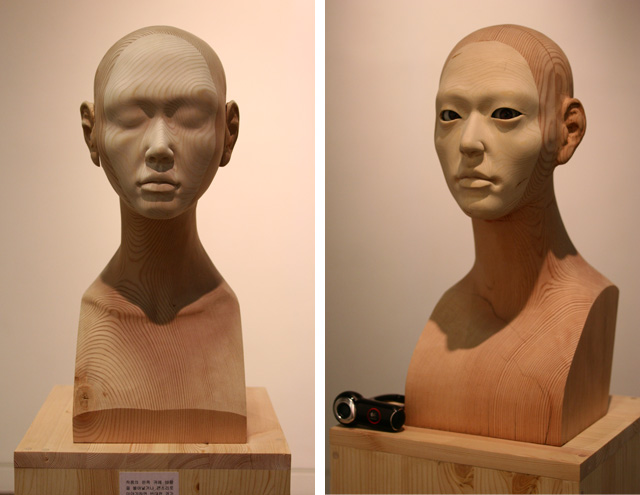
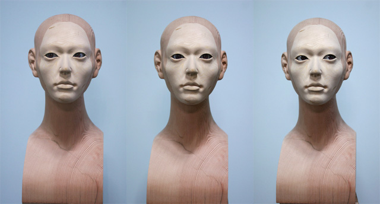
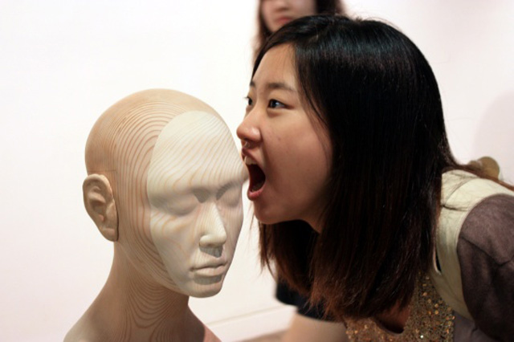
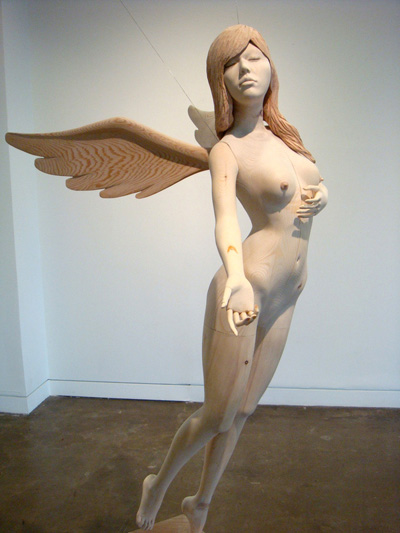

Technical support for Park Jong Young’s kinetic sculptures. Motion tracking controls the direction of a sculpture’s eyes, and sound input triggers the movement of an ear. The interaction was developed with Processing and Arduino.

