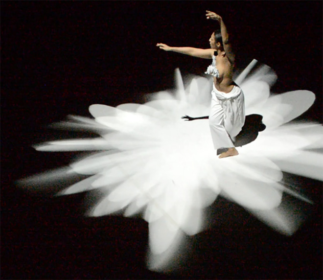

A contemporary dance project combining Korean dance with motion-responsive projected visuals. Motion-sensing input drives real-time graphics that follow and extend the performers’ movement. The program is recorded with BAM and GWU in January 2014 and September 2017.

The archive also records the same project under the title Cheonjiin — The Flow of Energy. That record includes an openFrameworks sketch reference and a sample video.

<iframe width="1120" height="630" src="https://player.vimeo.com/video/85700703" title="Embodied Cosmopolitanism / Cheonjiin — Cheonjiin — sample video" loading="lazy" allow="accelerometer; autoplay; clipboard-write; encrypted-media; gyroscope; picture-in-picture; fullscreen" allowfullscreen></iframe>

<iframe width="1120" height="630" src="https://player.vimeo.com/video/87040261" title="embodied-cosmopolitanism — archived video" loading="lazy" allow="autoplay; fullscreen; picture-in-picture" allowfullscreen></iframe>
