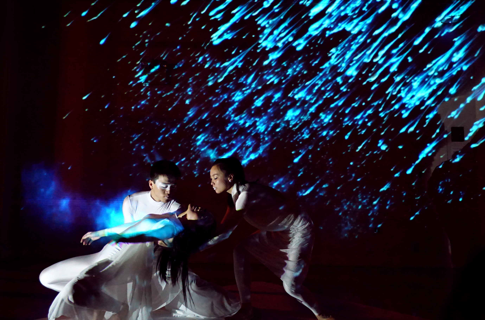
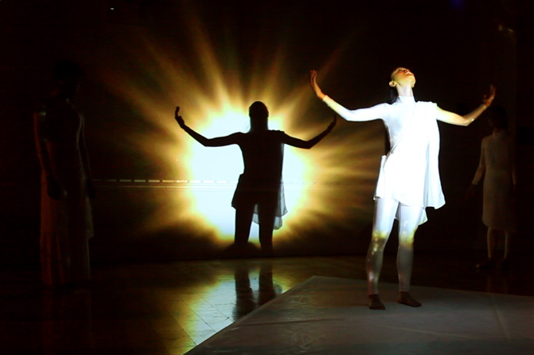
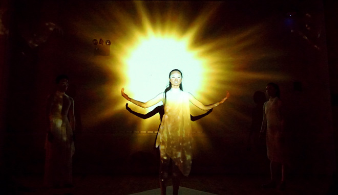
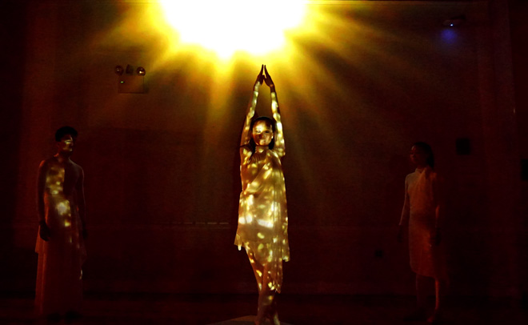
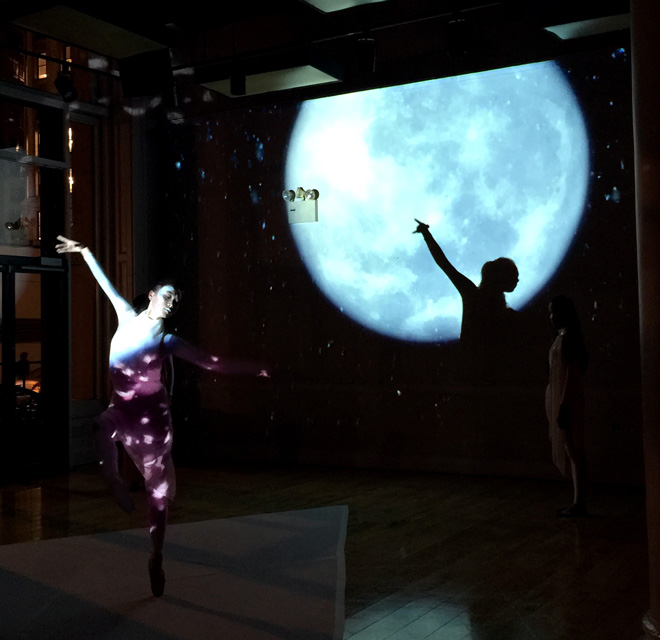
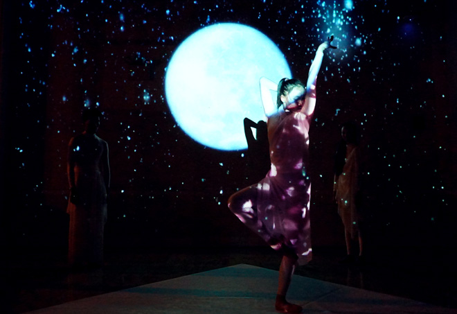
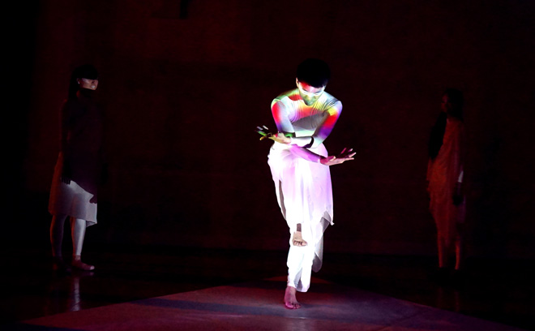
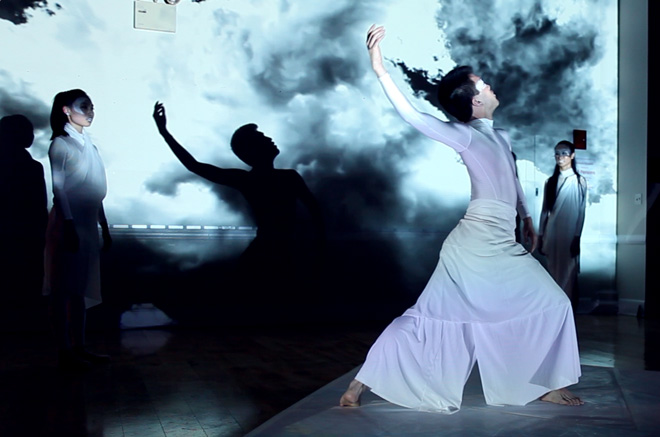
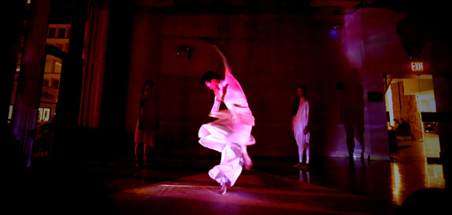
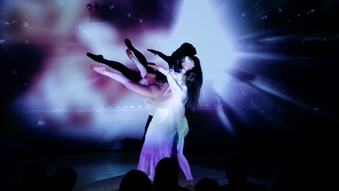

Equilateral combines dance and projected light, using the performer’s body as a projection surface. Three networked media stations are arranged at the corners of a triangle. They collect 3D motion-tracking data and produce real-time audiovisual responses.

The archive includes the performance and Body Mapper development demonstrations. The technical setup was also conceived as a framework that could be adapted for other live performances.

<iframe width="1120" height="630" src="https://player.vimeo.com/video/128632341" title="equilateral — archived video" loading="lazy" allow="autoplay; fullscreen; picture-in-picture" allowfullscreen></iframe>

<iframe width="1120" height="630" src="https://player.vimeo.com/video/124441530" title="equilateral — archived video" loading="lazy" allow="autoplay; fullscreen; picture-in-picture" allowfullscreen></iframe>

<iframe width="1120" height="630" src="https://player.vimeo.com/video/127064469" title="equilateral — archived video" loading="lazy" allow="autoplay; fullscreen; picture-in-picture" allowfullscreen></iframe>

<iframe width="1120" height="630" src="https://player.vimeo.com/video/124438145" title="equilateral — archived video" loading="lazy" allow="autoplay; fullscreen; picture-in-picture" allowfullscreen></iframe>
