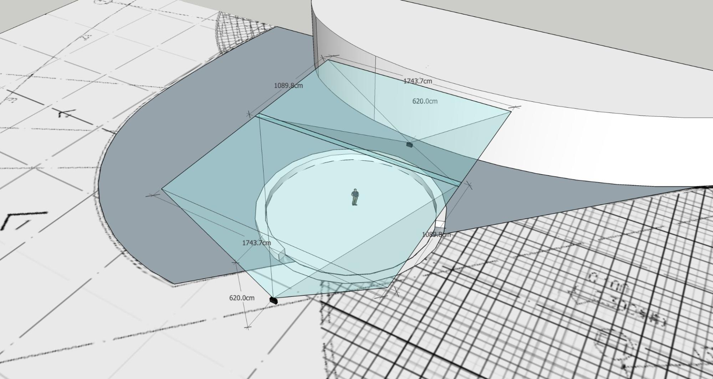
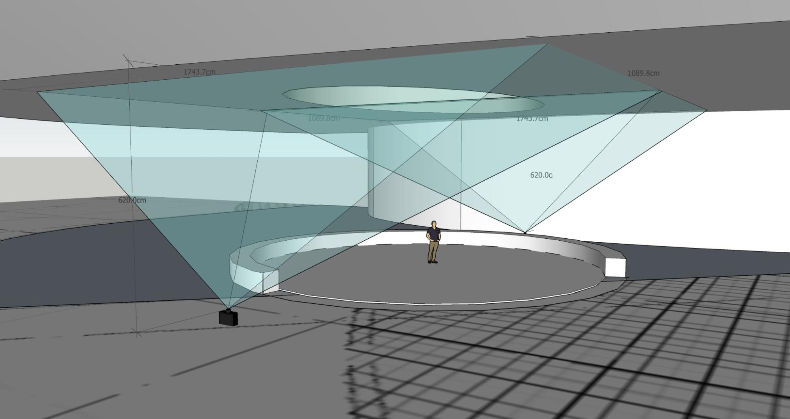
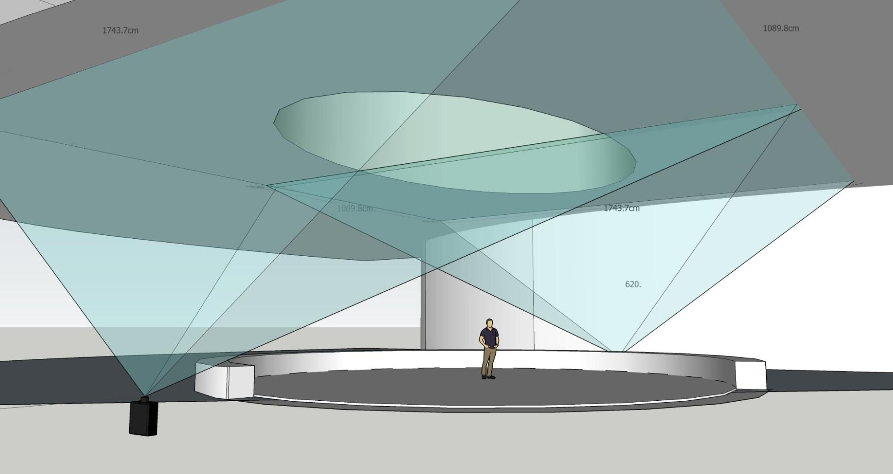
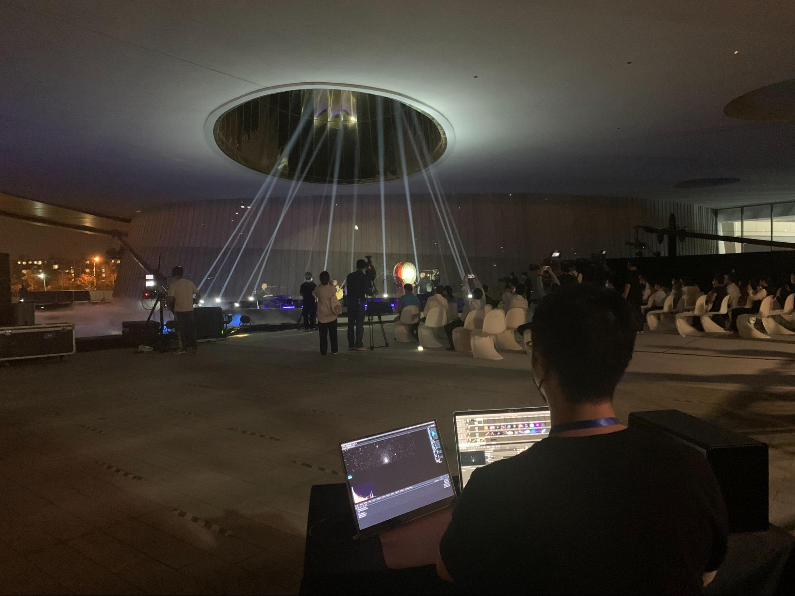
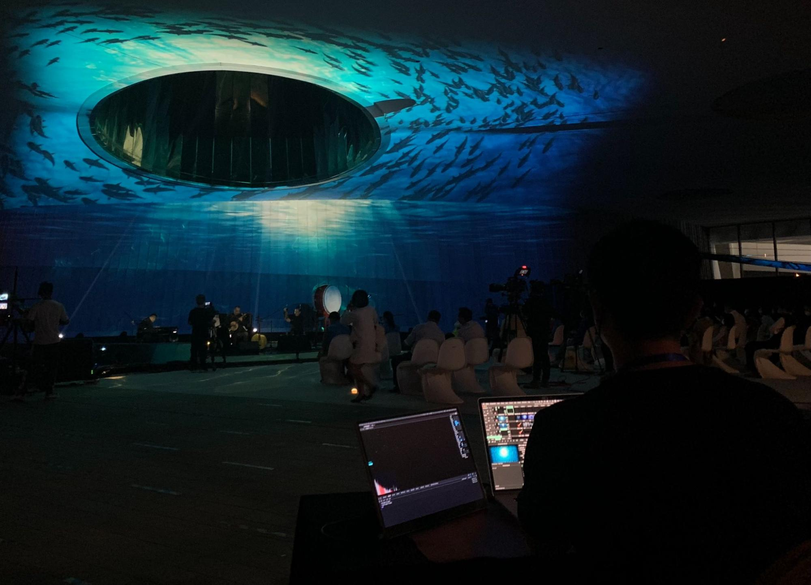
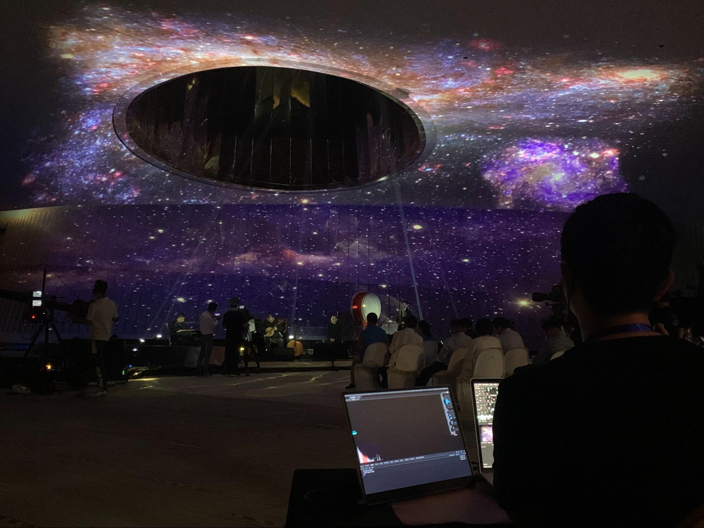
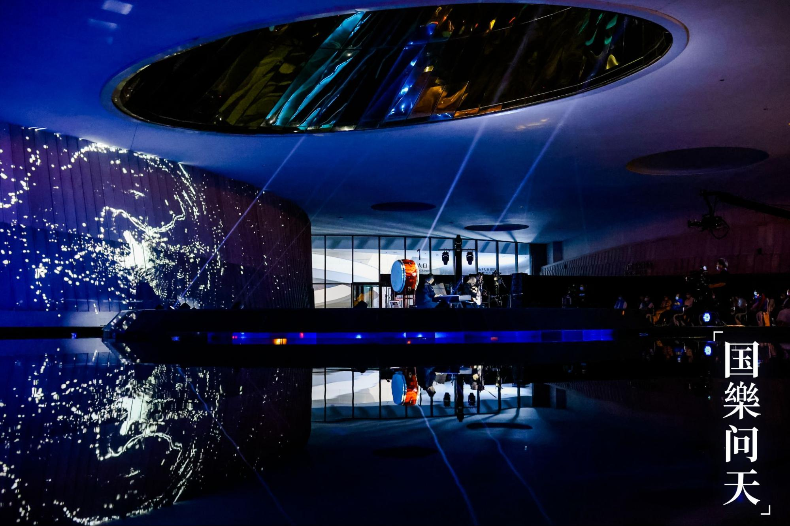
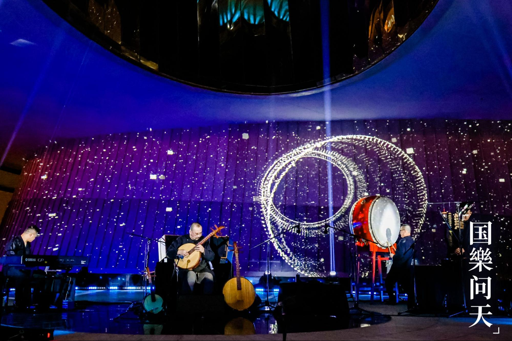
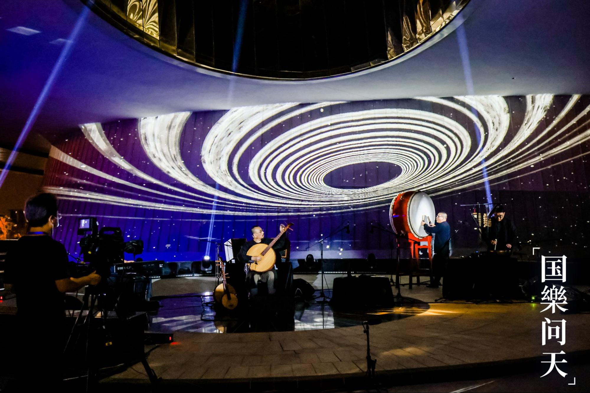
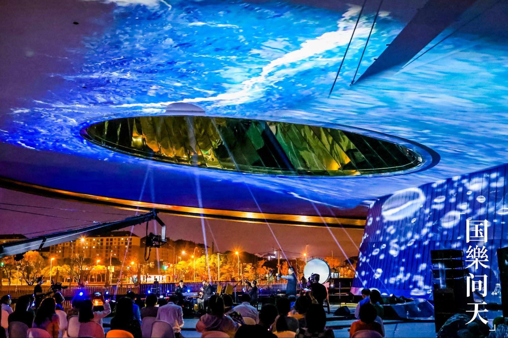

<iframe width="800" height="450" src="//www.youtube.com/embed/WxhK6FOfil4?feature=player_detailpage" frameborder="0" allowfullscreen></iframe>

## Role

I had the opportunity to collaborate with Chinese Moon Guitar master Feng Mantian and the creative organization inCulture. My responsibilities included:

- Media settings such as lighting and sound system configuration.
- Drafting a 3D simulation of the space to evaluate specifications for equipment (e.g., four 30,000 lumens projectors).
- Developing 30+ interactive visual scenes using particle systems and video footage.
- Tools used: **Three.js** and **Resolume**.

