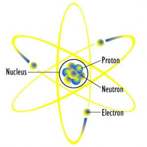
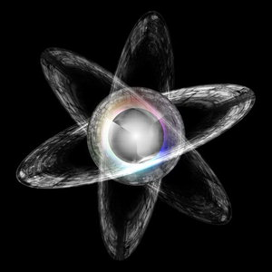
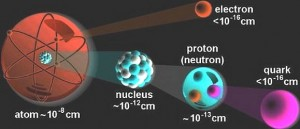
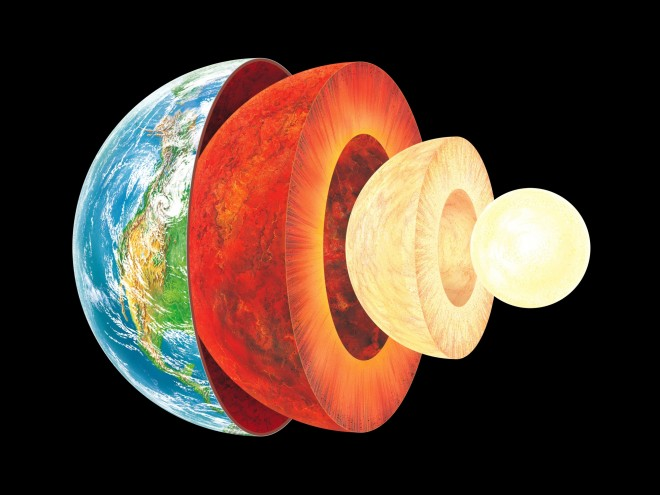
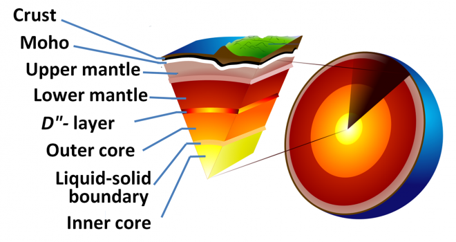

A group of coding studies archived as Supernova, Tree, and Particle System. The surviving records include openFrameworks/C++ code for particle motion, forces, branching structures, and visual rendering. They are grouped here as experiments rather than separate finished commissions.

- [Video](https://vimeo.com/86268192)
