Gift is recorded as a hybrid musical presented at Jangcheon Art Hall, Seoul, on July 5, 2013.

Stage documentation shows projected visual material used in the production.

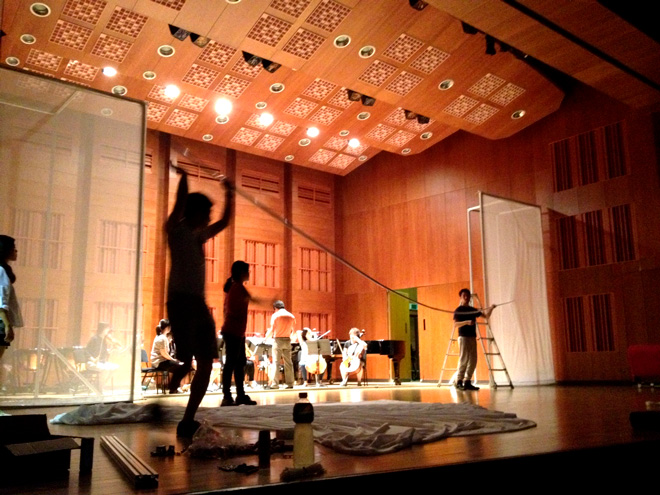

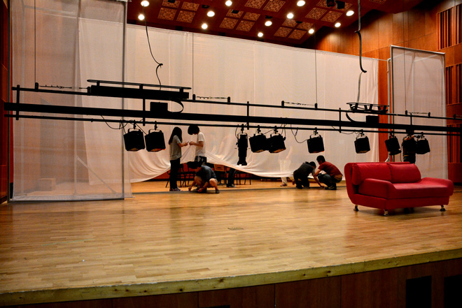

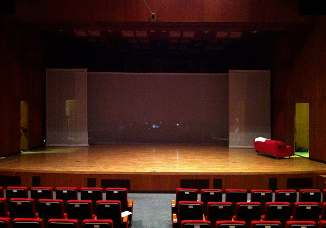

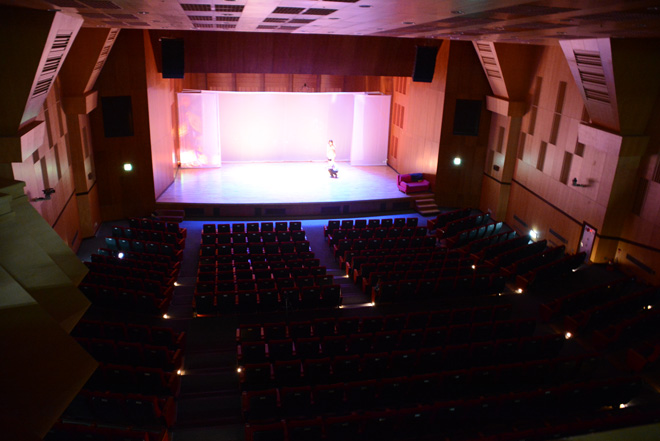

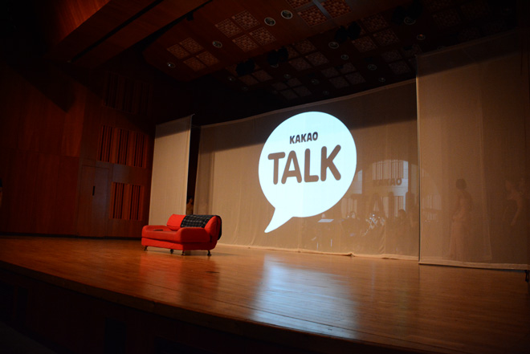

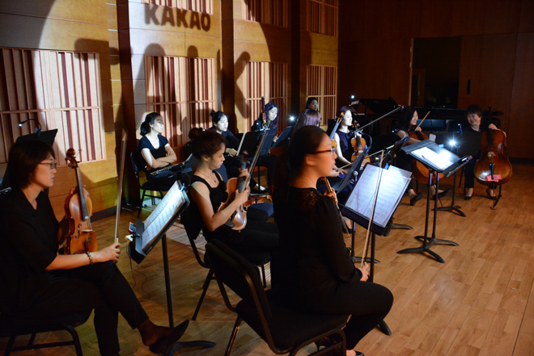

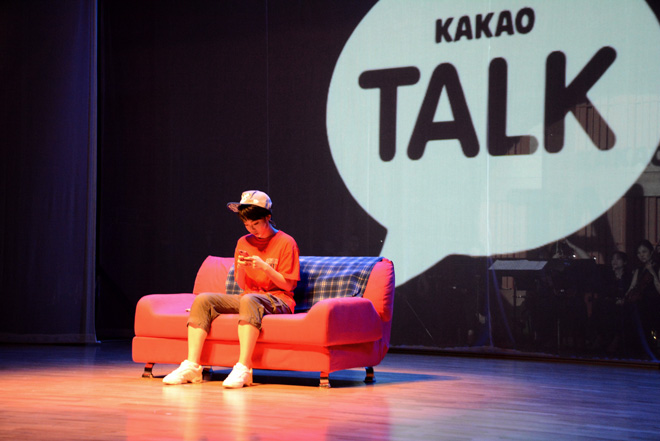

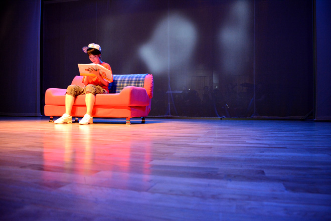

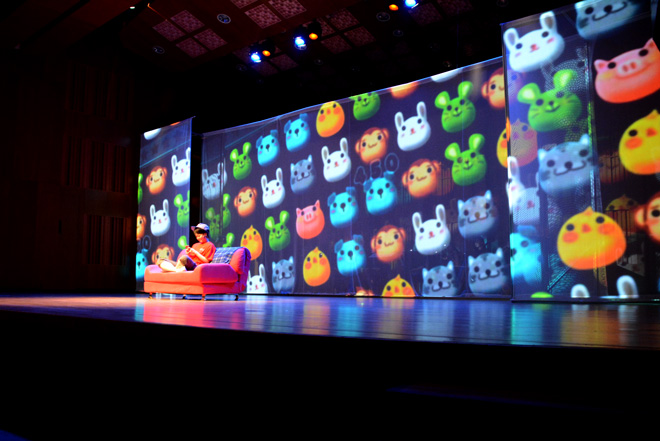

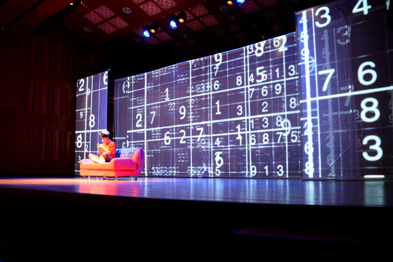

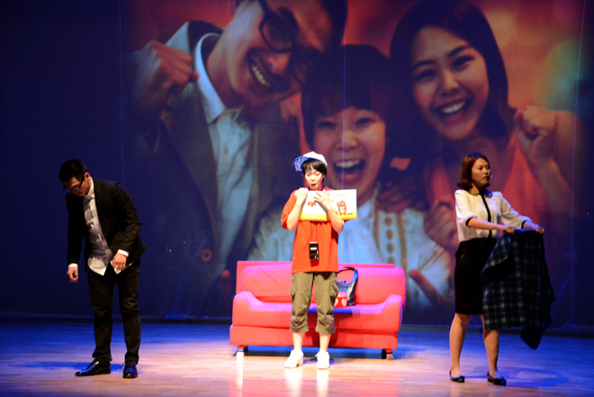

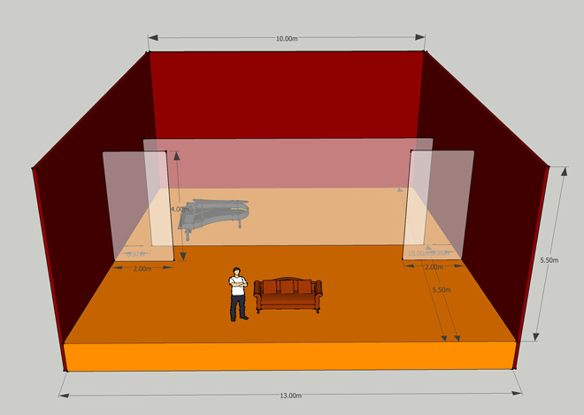

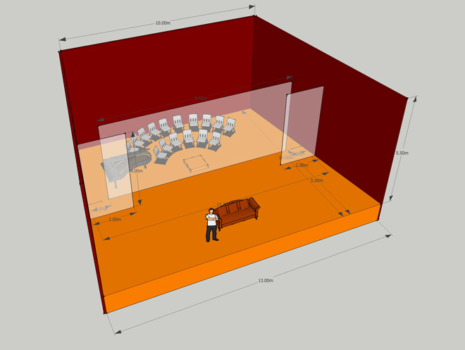

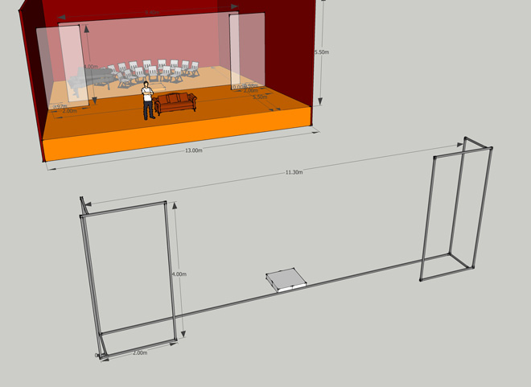

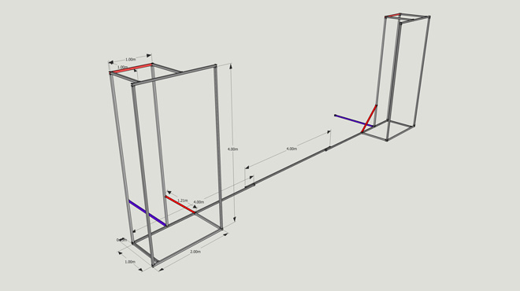

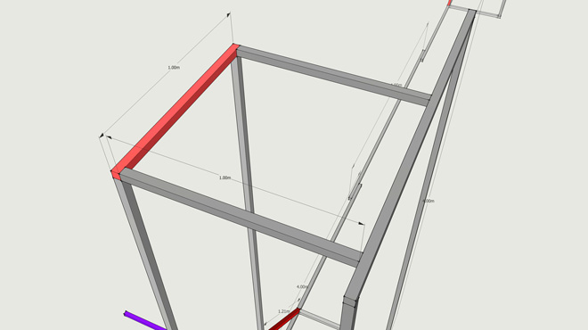

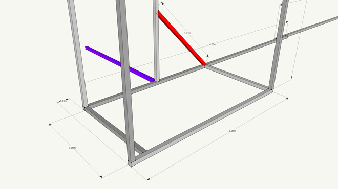

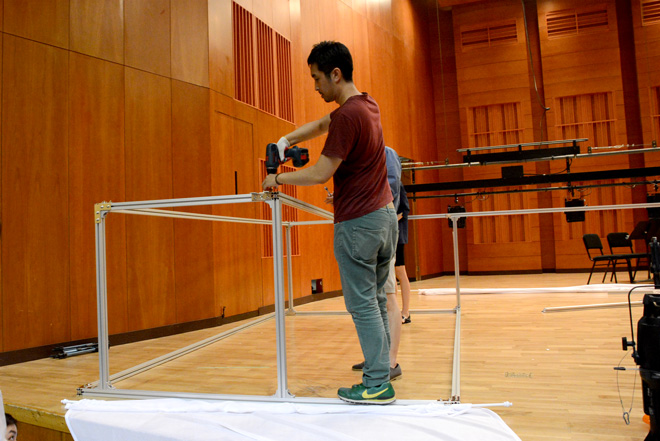

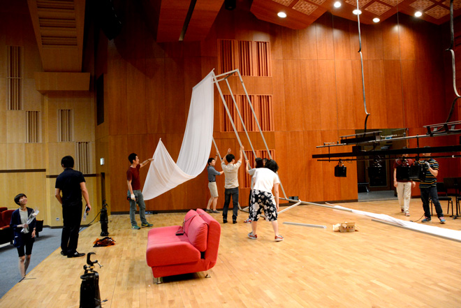

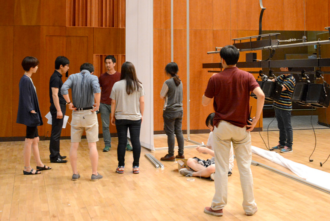

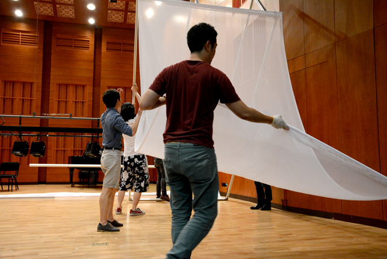
