A workshop project connecting drawing, body movement, and visual media at the Shanghai Improvisation Festival. Traditional and VR drawing methods were used alongside a custom drawing application and motion tracking.

The 2019 program ran from August 23 to September 1. The 2021 session took place on October 5 as part of the 4th Shanghai Improvisation Festival, with the themes Breaking, Reconstruction, and Transformation. Participants came from dance, music, theatre, architecture, and lighting.

[2019 workshop announcement](https://mp.weixin.qq.com/s/cjgwilVnz09nKBiwQ2-iVQ)

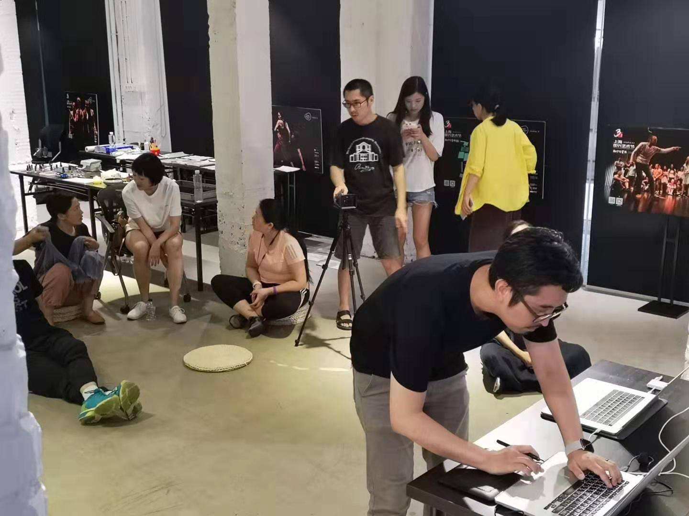

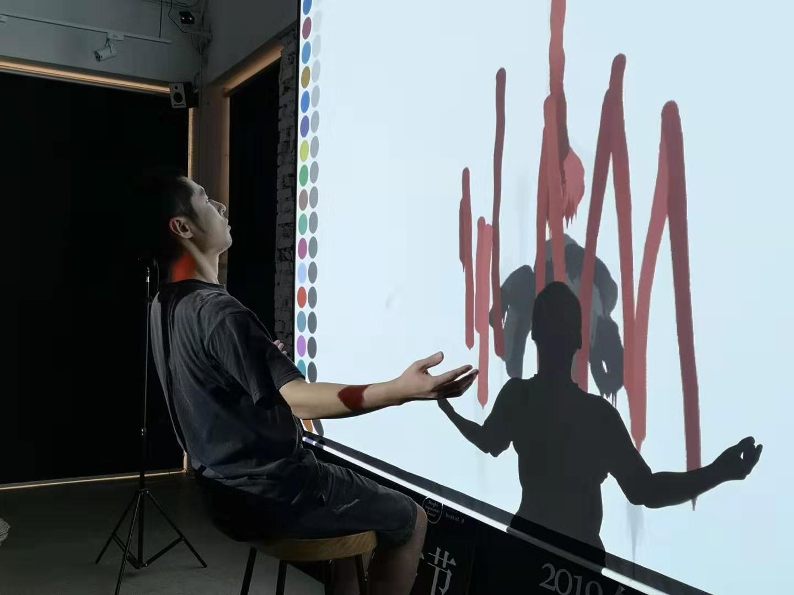

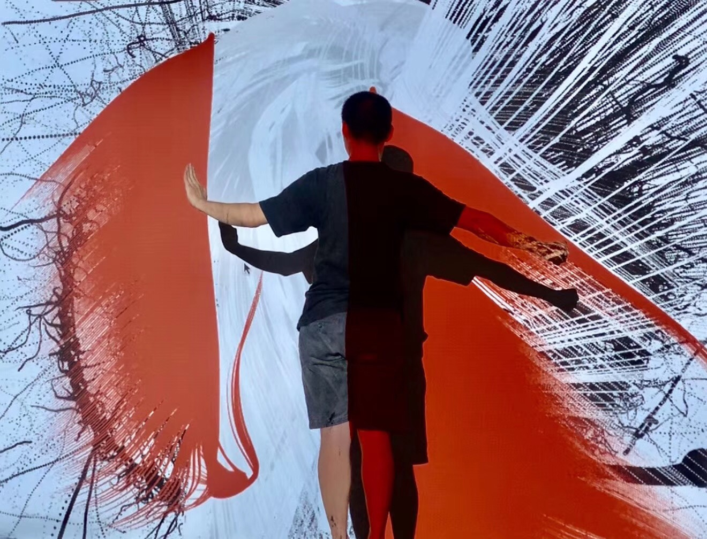

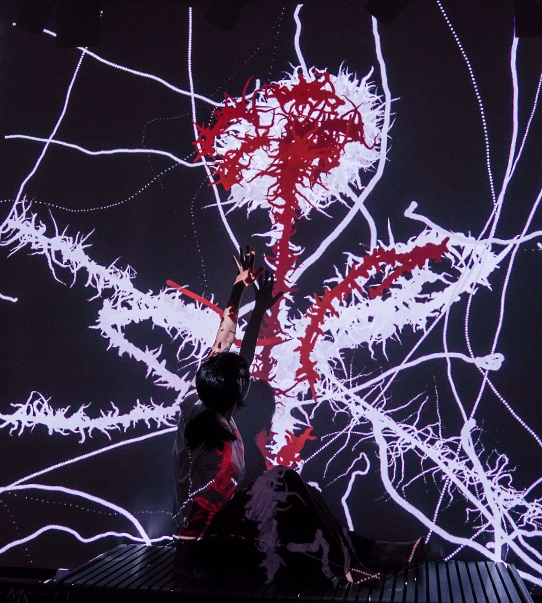

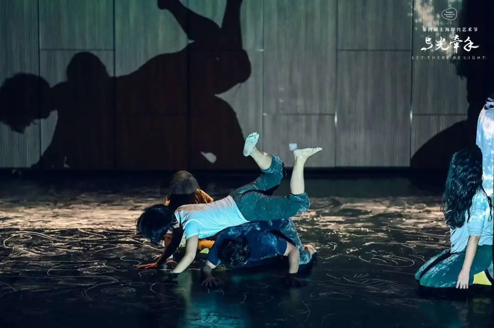

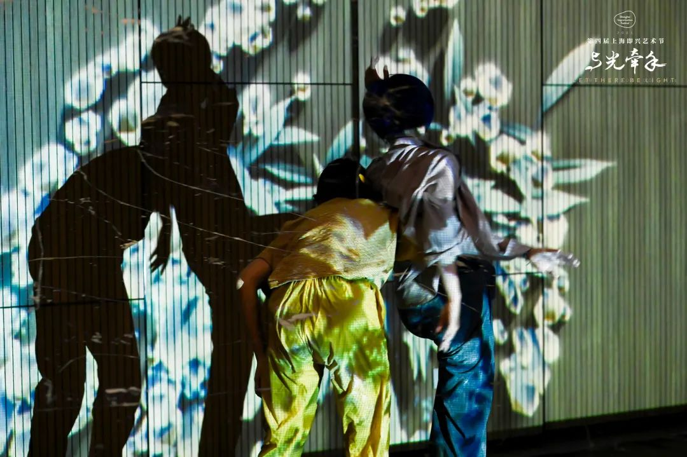

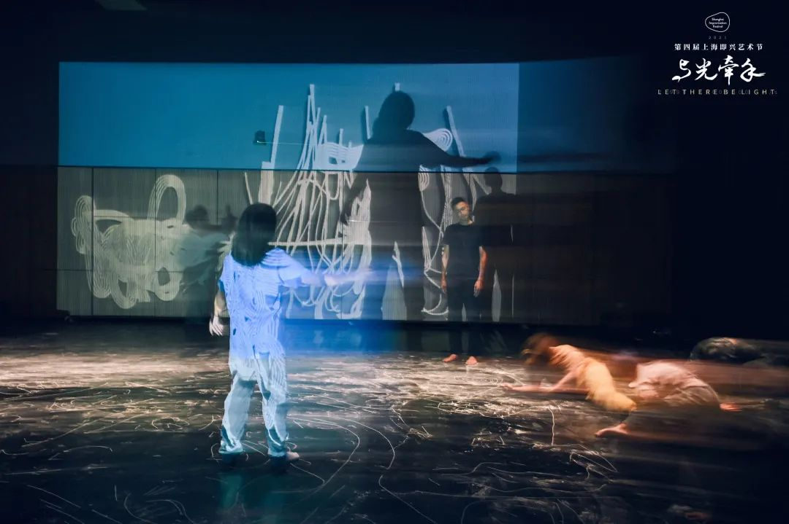

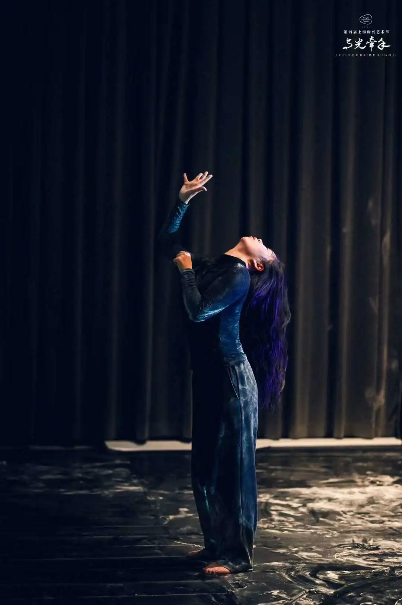

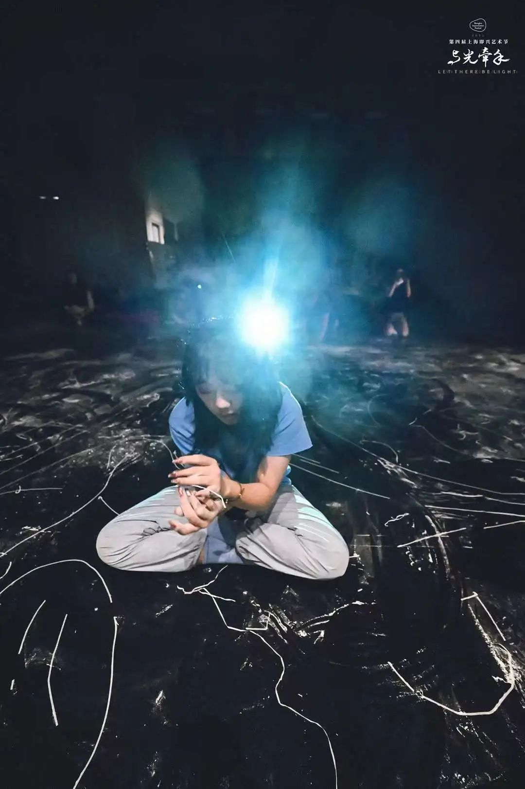

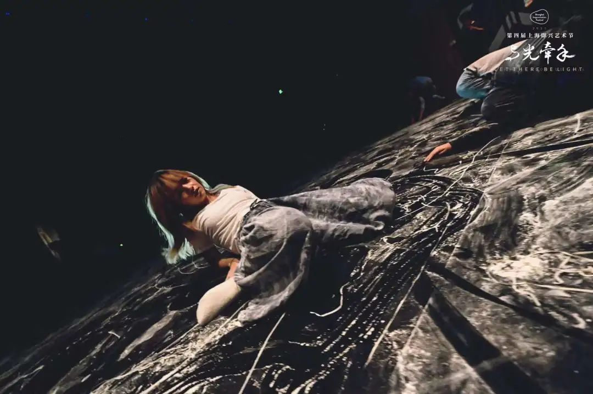

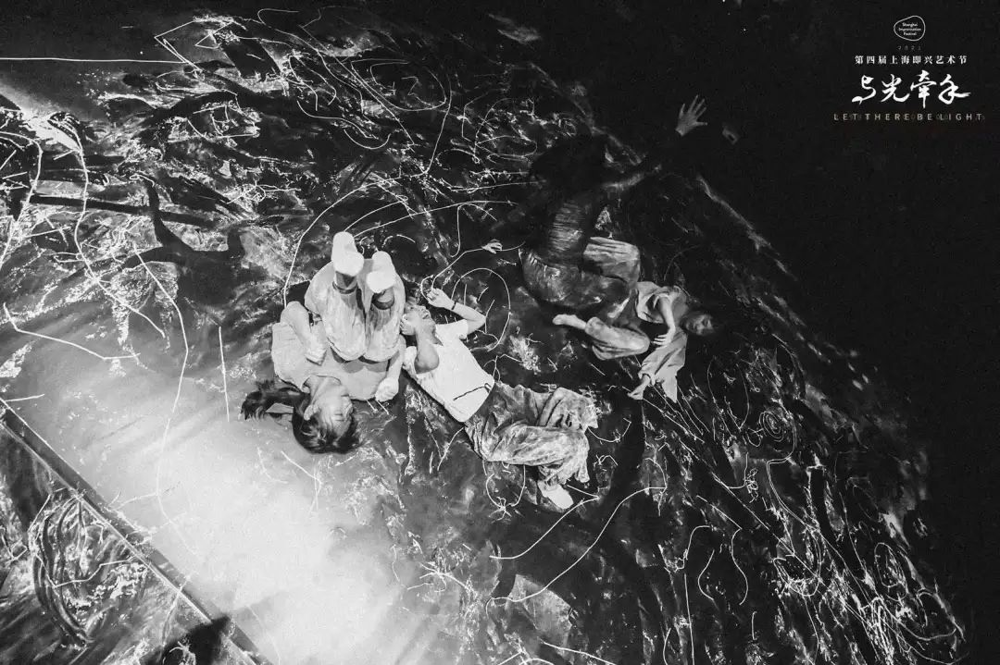

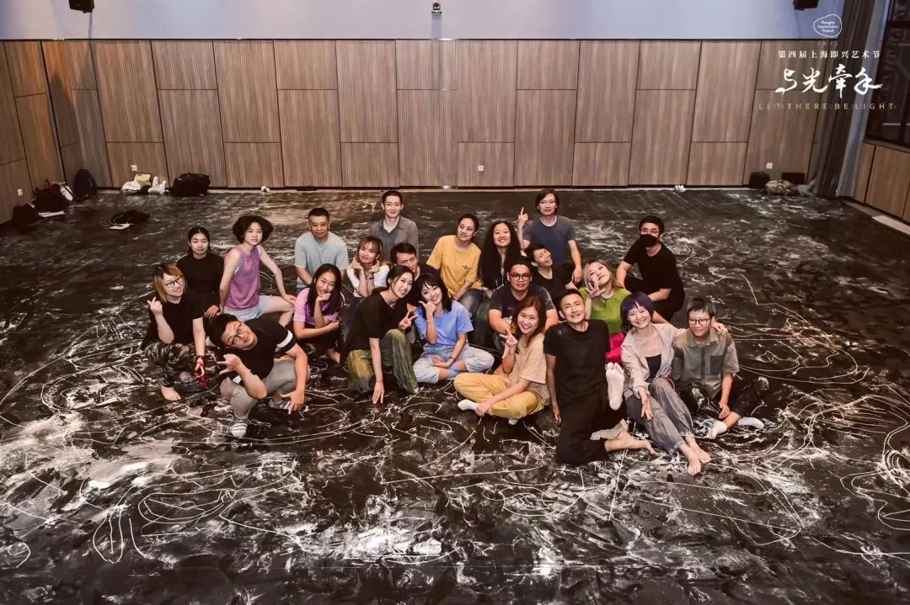
