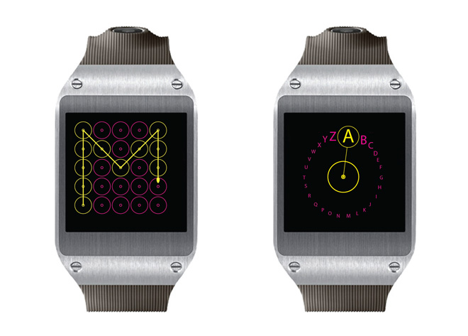
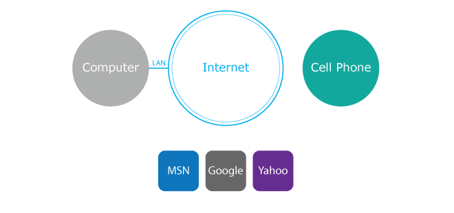
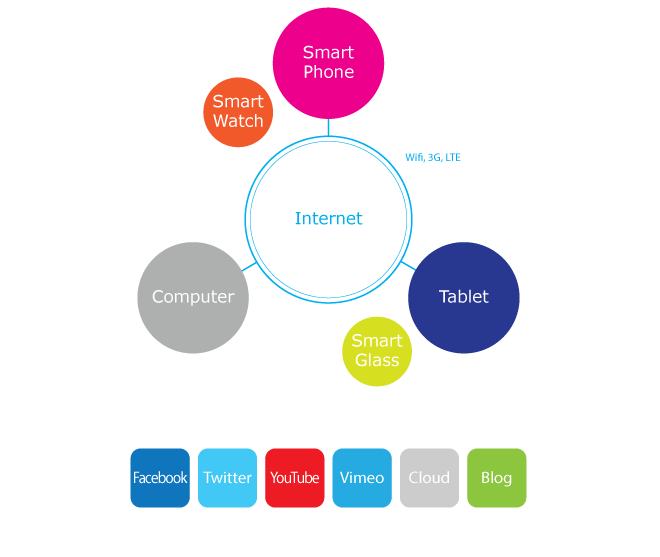
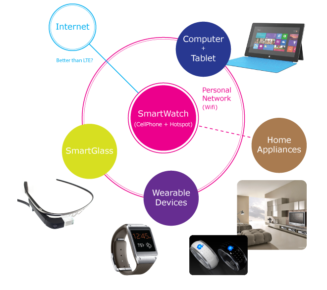
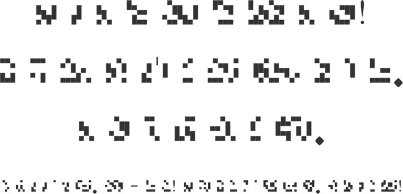
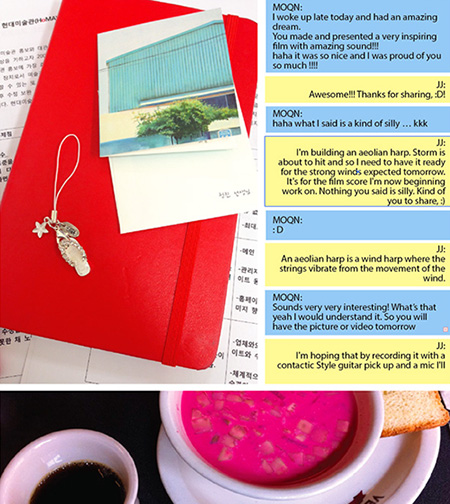
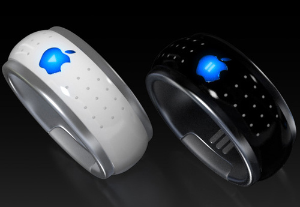
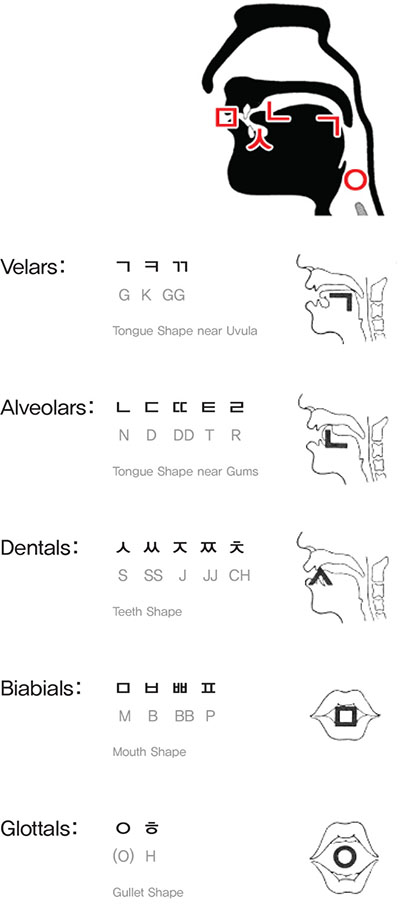
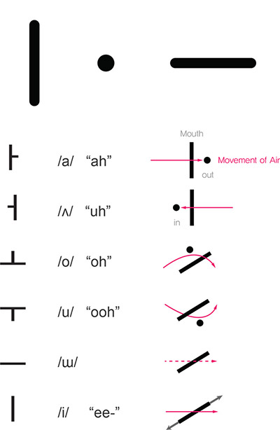

Research notes explore text entry and reading on small displays, Korean alphabet construction, and ways to organize social records. The material consists of proposals and interface studies rather than a completed product.

Further documentation pending.

