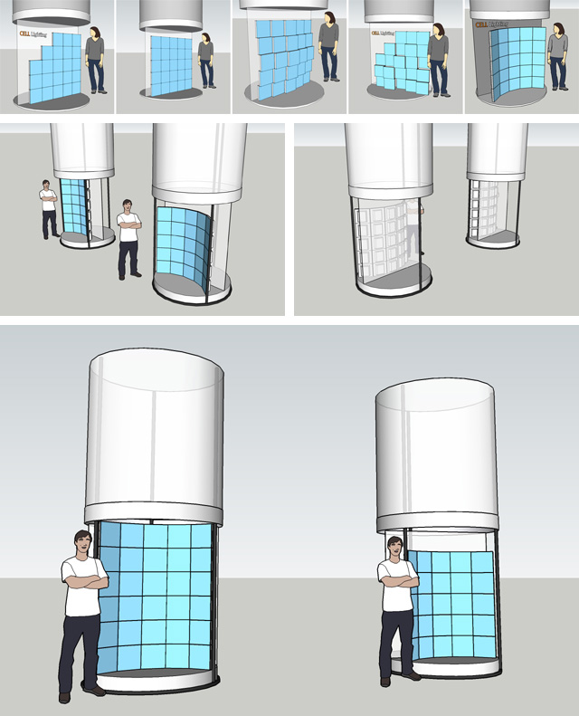
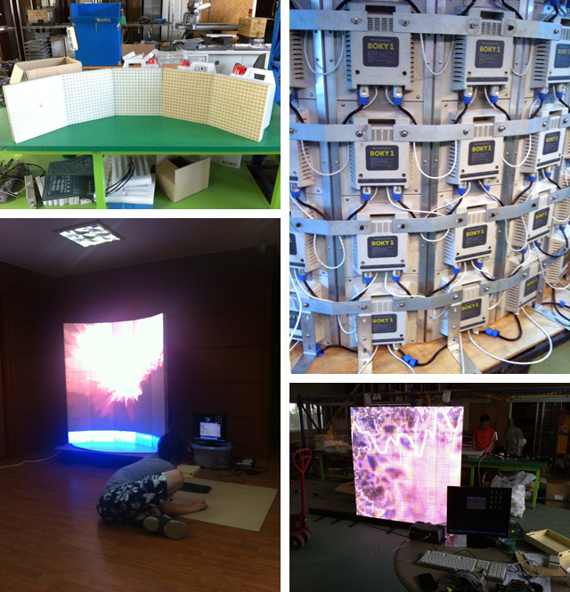
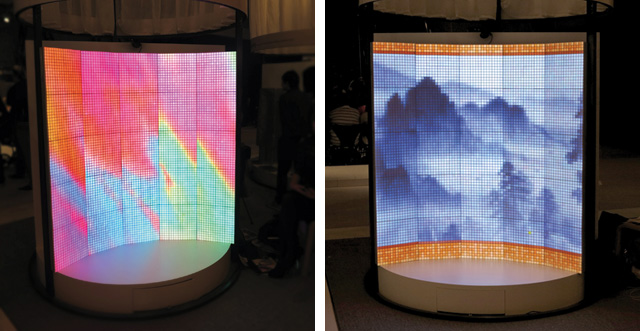
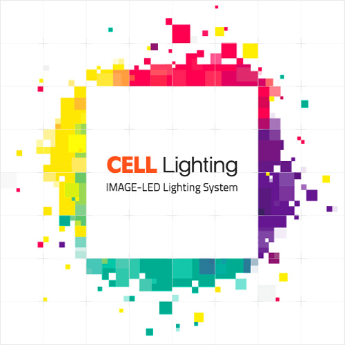
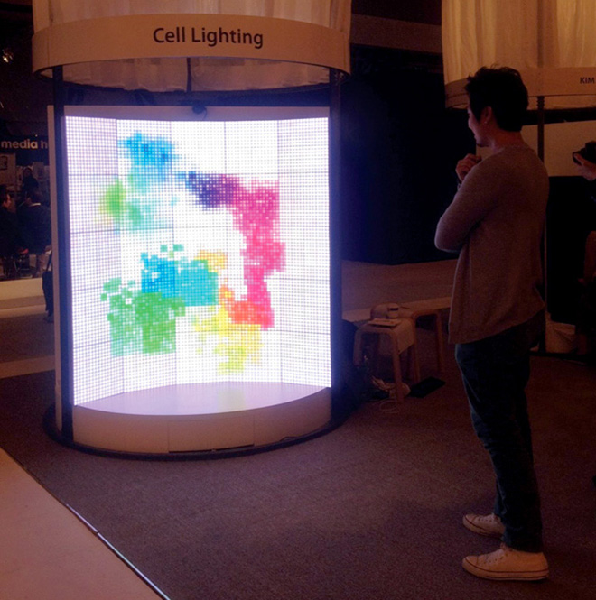
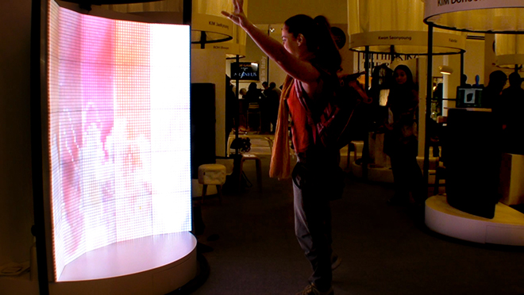
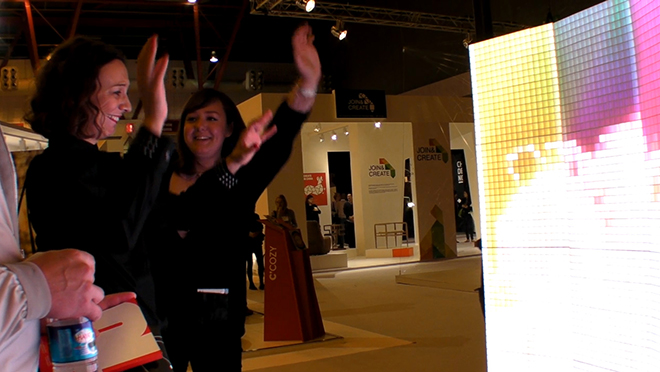
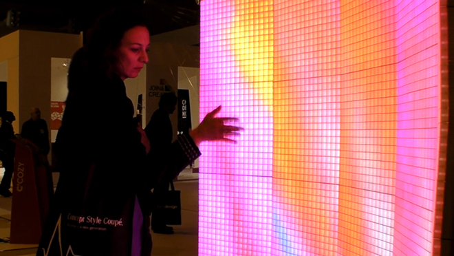
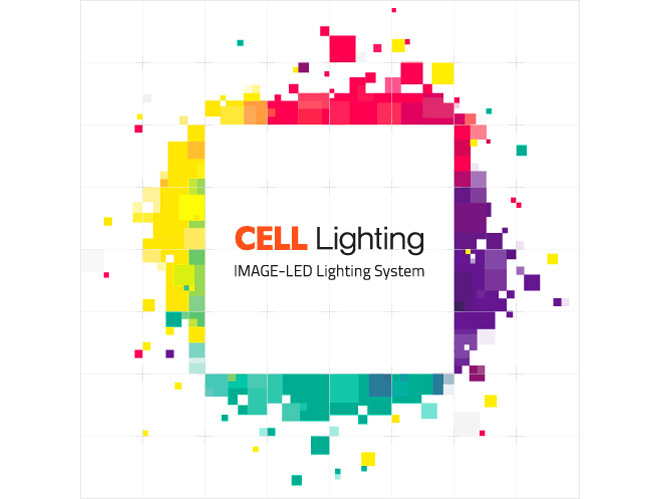

An LED installation presented at 100% Design London. The work combined Kinect-based silhouette and hand tracking, microphone input, sound visualization, and motion graphics.

The same project is recorded in the archive as Nemo — London.

Responsibilities included art direction, leading a five-person team, arranging display units, and developing interactive content.

<iframe width="1120" height="630" src="https://player.vimeo.com/video/57201498" title="Interactive LED at 100% Design London — Video" loading="lazy" allow="accelerometer; autoplay; clipboard-write; encrypted-media; gyroscope; picture-in-picture; fullscreen" allowfullscreen></iframe>

