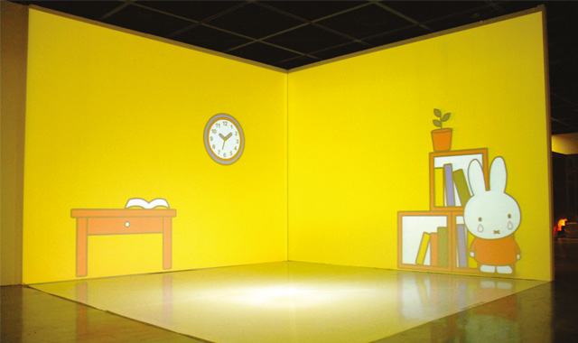
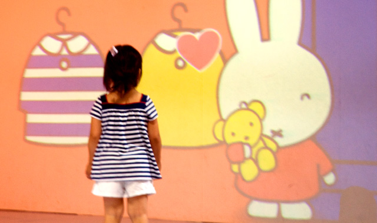
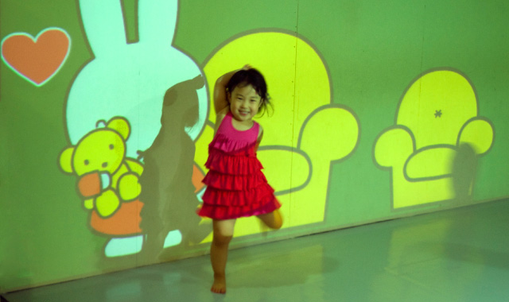
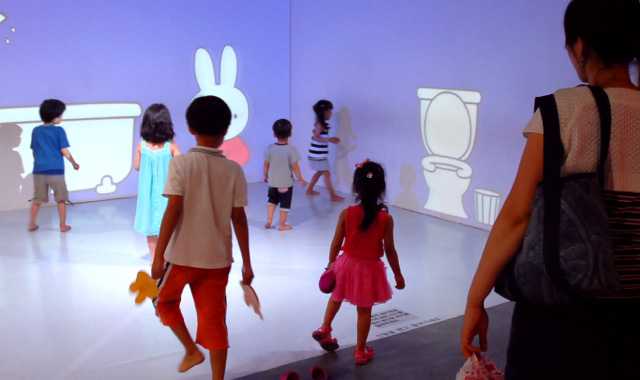
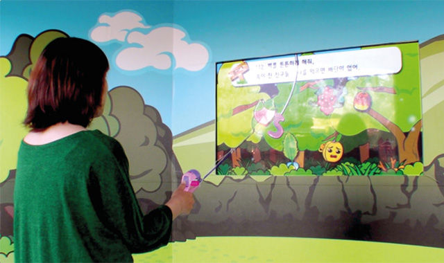
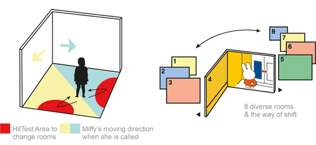
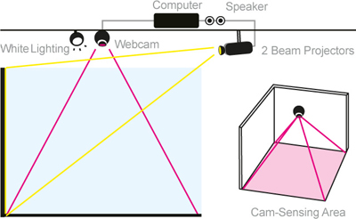
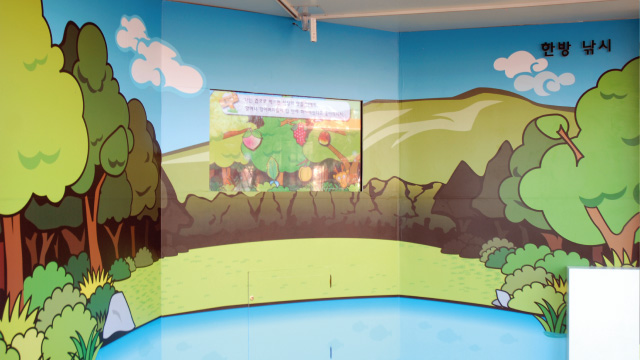
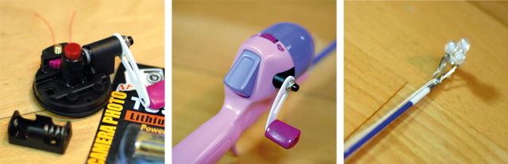
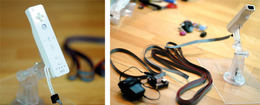

A collection of installations for children using motion, sound, and infrared input. In Why Is Miffy Crying?, movement changes rooms in the projected scene and sound calls Miffy toward the visitor.

The archive also documents Fishing Oriental Medicine at Jecheon EXPO (2010), Let’s Catch the Bugs at EBS (2009), and presentations at children’s exhibitions and the Science Family Festival.

- [Video 1](https://vimeo.com/34355435)
- [Video 2](https://vimeo.com/34366327)
