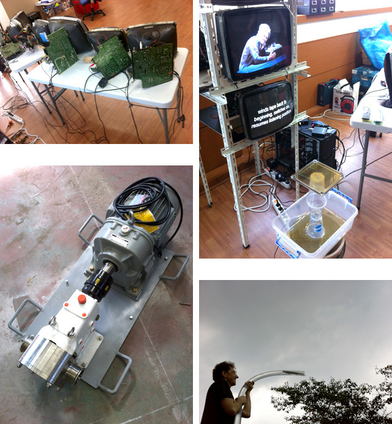
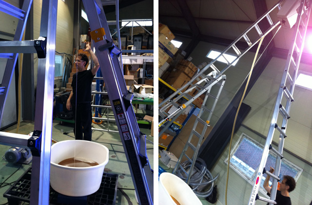
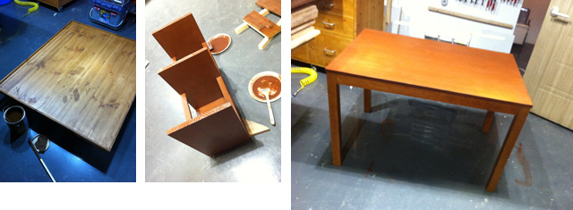
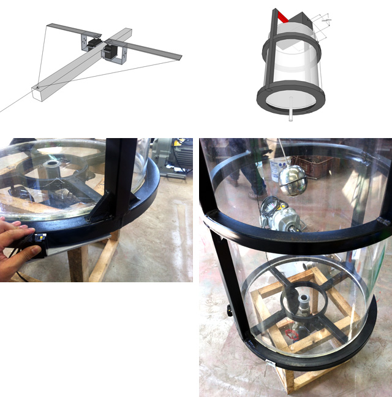
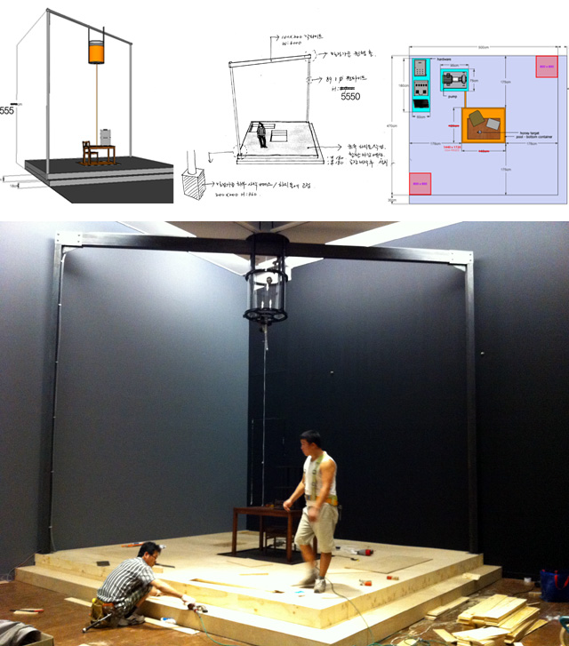
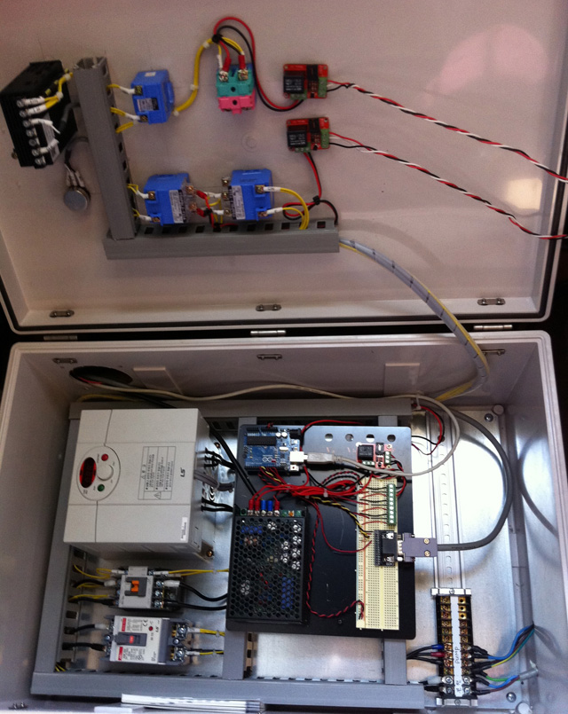

Production assistance for Romy Achituv’s Krapp’s Last Tape. Work included pump automation, circuit assembly, a servo-driven container mechanism, limit-switch programming, carpentry, staining, CRT disassembly, and supplier coordination.

