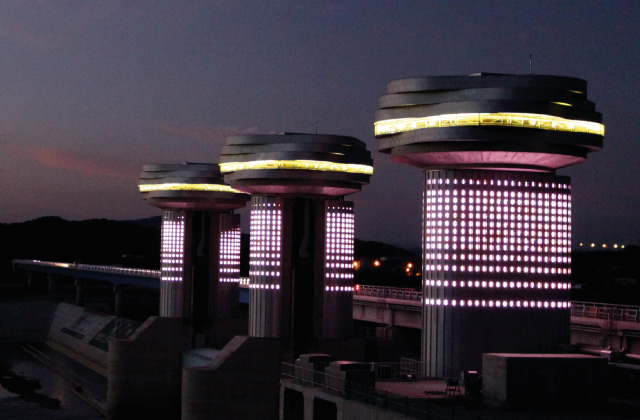
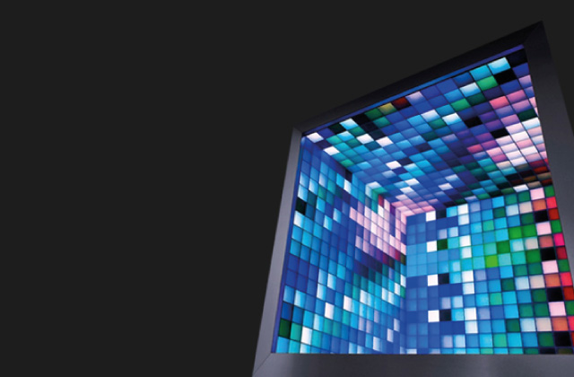
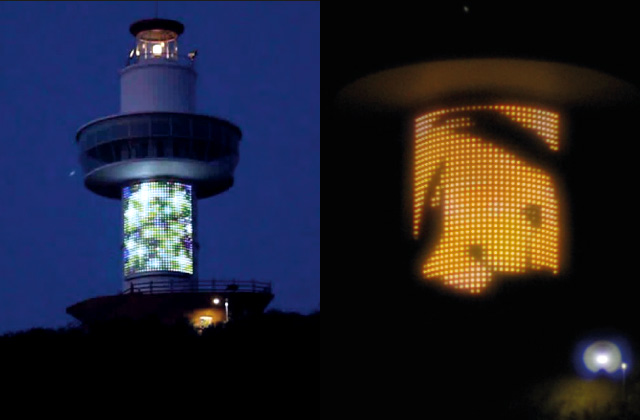
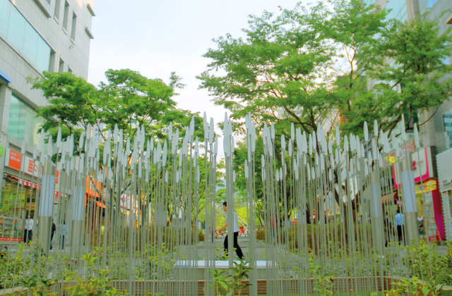
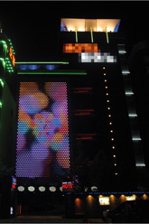
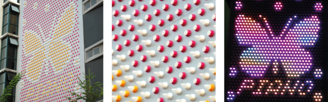
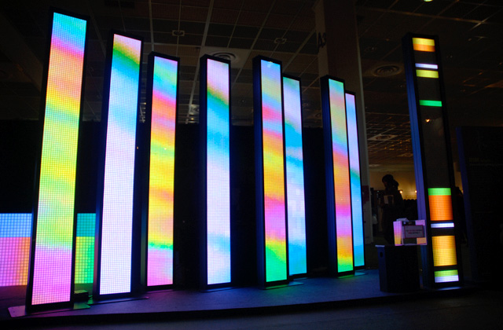
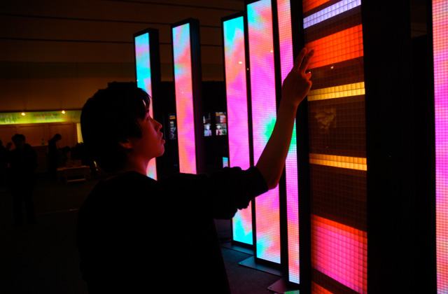
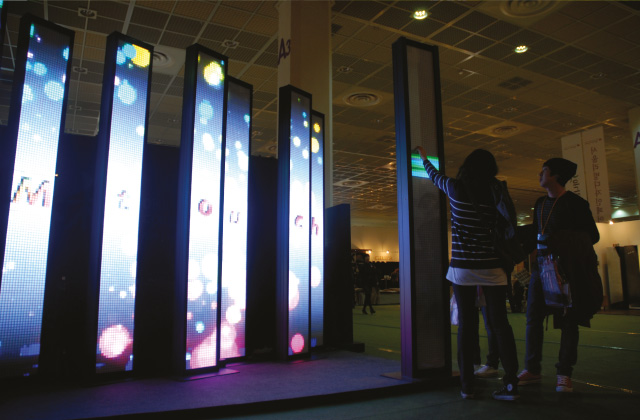
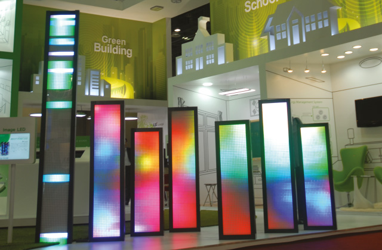

Visual and conceptual work for LED installations with CELL Lighting. The archive documents projects at Sangju Weir, a lighthouse in Yeongdeok, LED Reed in Daegu, and Geobukseon Bridge in Yeosu.

Other records include display simulations, exhibition lighting, and a touch-responsive LED system developed with Hive. Responsibilities varied by project; the archive describes art direction, visual content, and conceptual work.

- [Video 1](https://vimeo.com/34356573)
- [Video 2](https://vimeo.com/34366431)
