Visual and conceptual work for LED installations with CELL Lighting. The archive documents projects at Sangju Weir, a lighthouse in Yeongdeok, LED Reed in Daegu, and Geobukseon Bridge in Yeosu.

Other records include display simulations, exhibition lighting, and a touch-responsive LED system developed with Hive. Responsibilities varied by project; the archive describes art direction, visual content, and conceptual work.

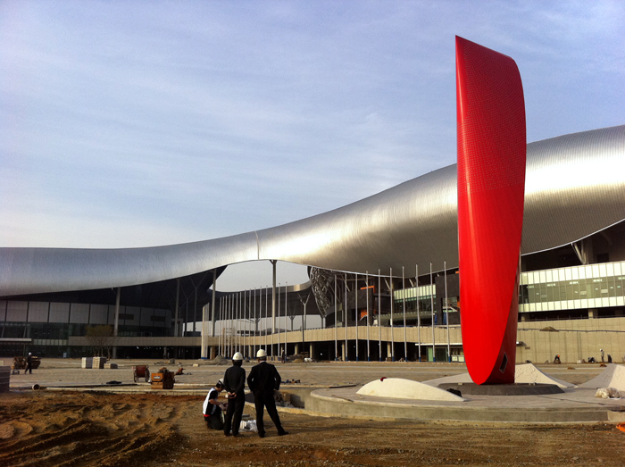

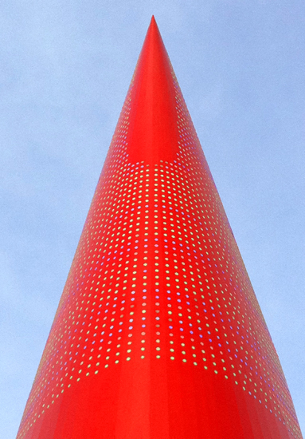

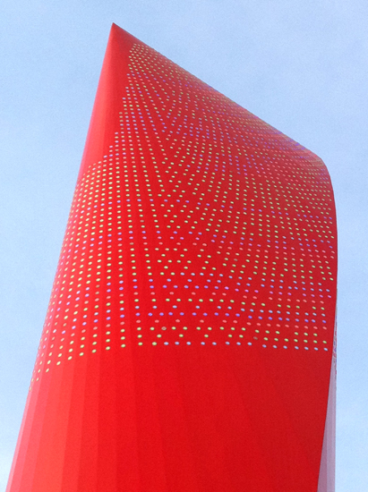

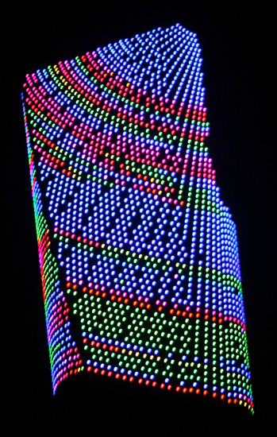

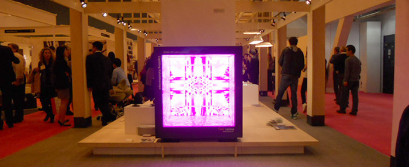

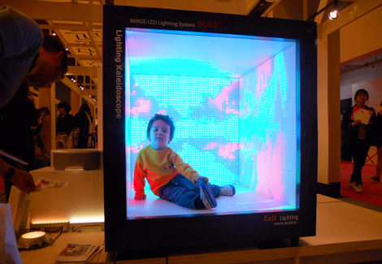

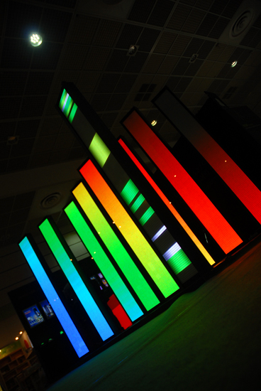

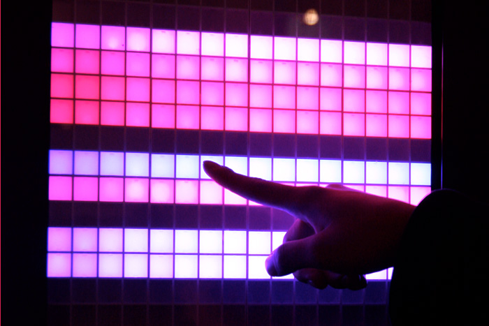

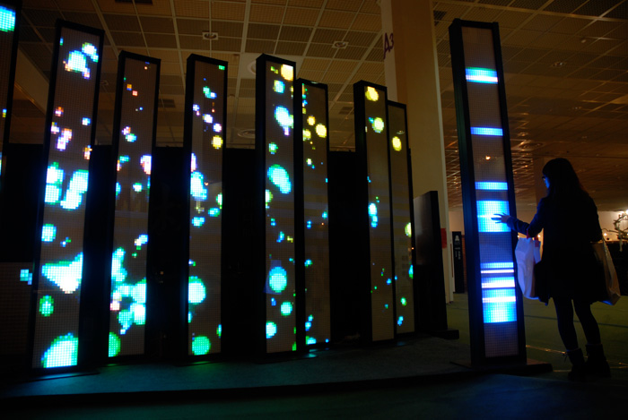

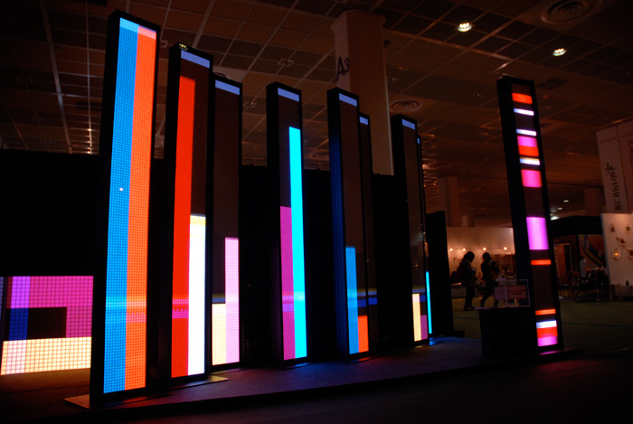

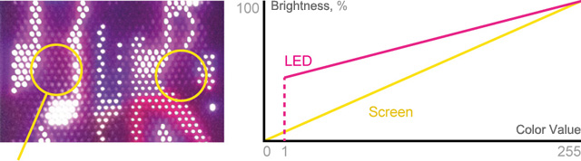

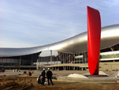

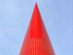

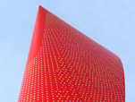

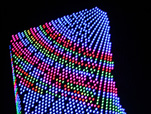

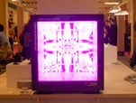

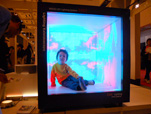

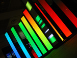

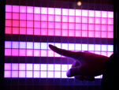

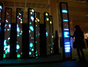

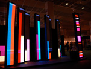

<iframe width="1120" height="630" src="https://player.vimeo.com/video/34356573" title="LED Media Facades — Video 1" loading="lazy" allow="accelerometer; autoplay; clipboard-write; encrypted-media; gyroscope; picture-in-picture; fullscreen" allowfullscreen></iframe>

<iframe width="1120" height="630" src="https://player.vimeo.com/video/34366431" title="LED Media Facades — Video 2" loading="lazy" allow="accelerometer; autoplay; clipboard-write; encrypted-media; gyroscope; picture-in-picture; fullscreen" allowfullscreen></iframe>
