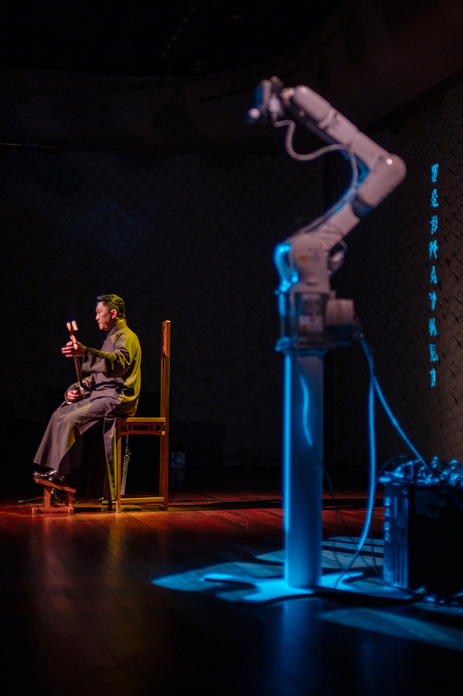
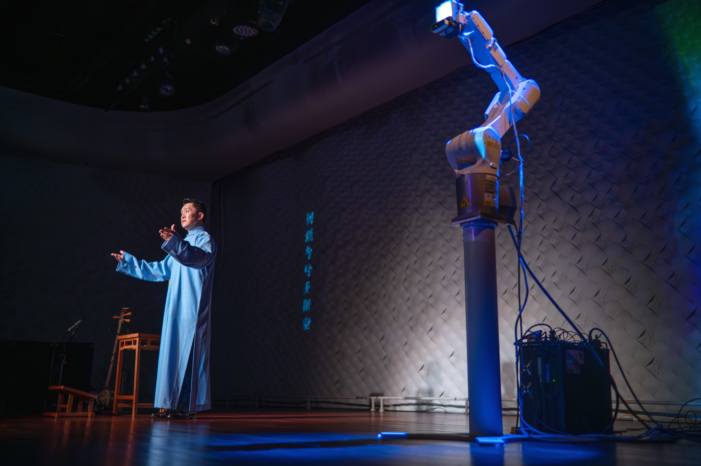
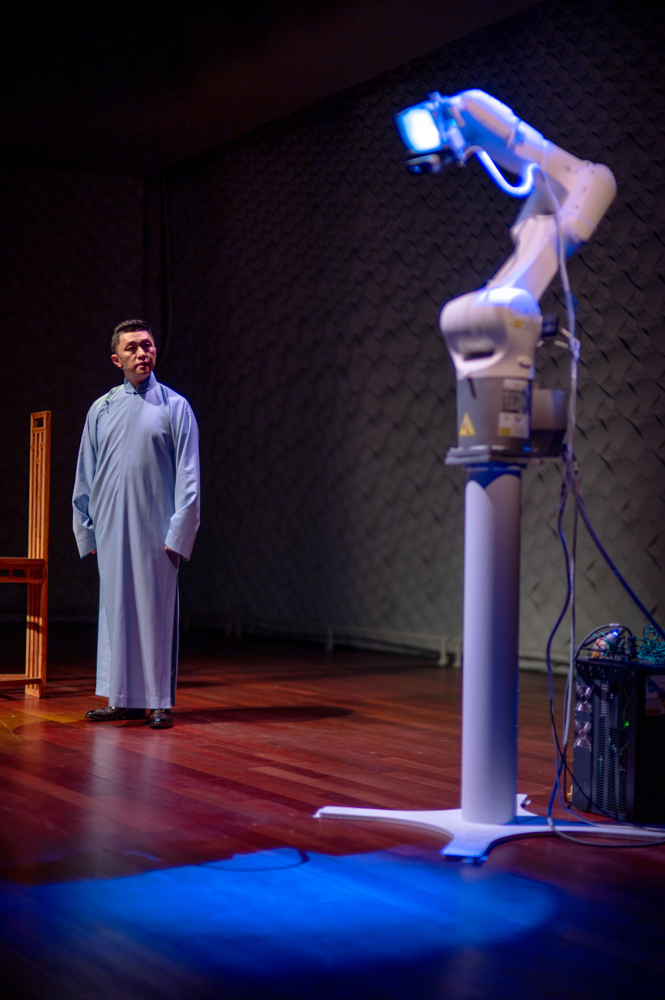
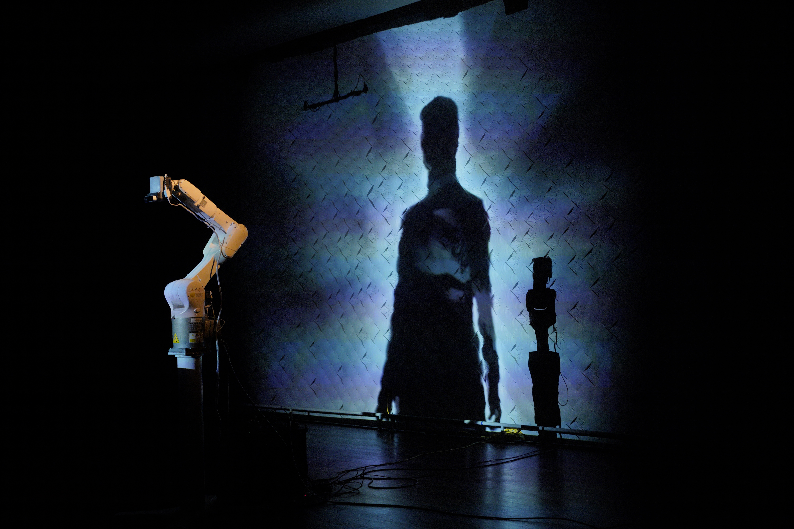
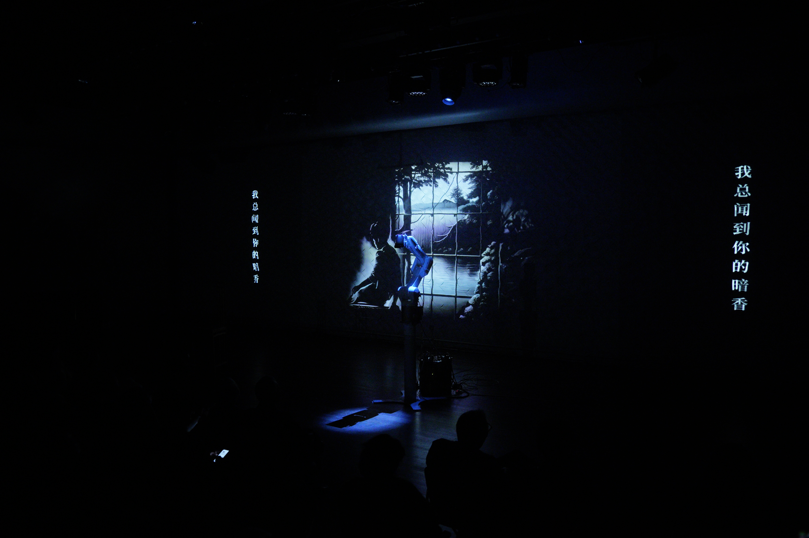
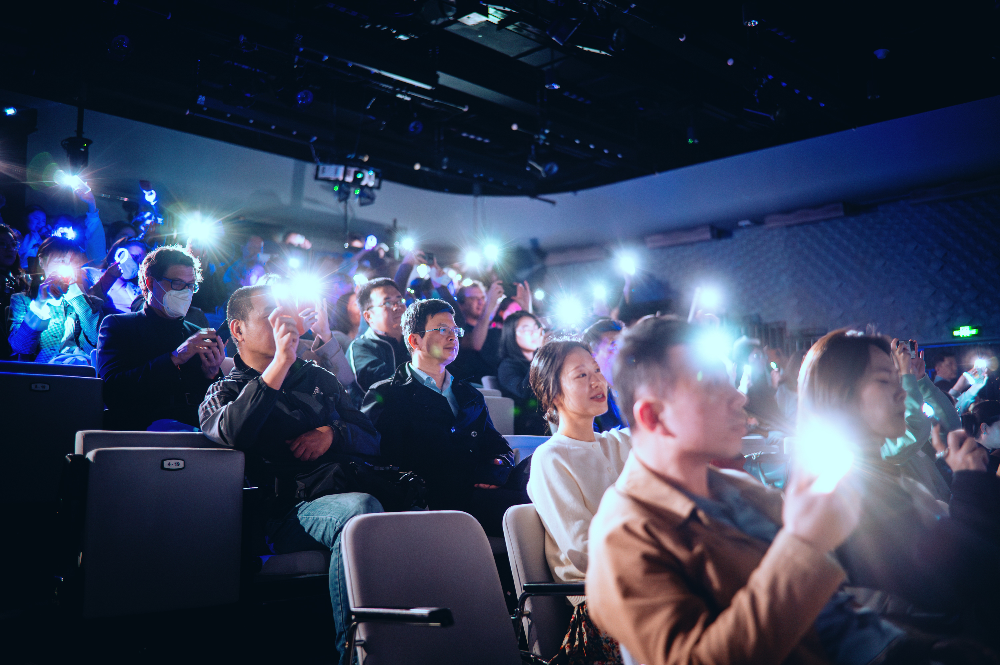

Melodic Echo Odyssey is a narrative concert combining Pingtan, AI-generated imagery and music, live media processing, and a robotic arm. It was presented at Shanghai Concert Hall on April 17–18, 2024.

## Role

Work included media and technology operation, interactive-system development, integration of AI-generated content, and interfaces for real-time control. A subtitle system was developed to coordinate text with the performance.

## Development

Robotic-arm movements were prepared in Rhino and triggered during the performance. Computer vision, generative media, and pre-programmed robotic movement were integrated with live processing.

<iframe width="800" height="450" src="https://www.youtube.com/embed/Jy67K_ND3QQ" frameborder="0" allowfullscreen></iframe>

## Credits

Producer: Zhang Yinan

Director &amp; Artistic Director: Li Yuejuan

Scriptwriter &amp; Stage Supervisor: Liu Jing

Performer: Bowen Gao

Media and Technology Operation: Jung Hyun Moon

Interactive System Development: Jung Hyun Moon

Robotic Arm Development: Zheng Kangyi

Project Coordinator: Zhang Ruoyu

AI Technology Support: Guo Weiwei

Cultural Advisors: Yan Banzhi, Yun Jiayan, Ding Xia, Chen Yixin

Calligraphy Creation: Ye Jiayi

Lighting Design: Shen Yun

Lighting Execution: Hou Yinzhu

Costume and Makeup Consultant: Zhuo Yanran

Design and Development Team: Cao Yanbin, Wang Ziyu, Tian Yanrong, Fu Yutong, Shi Lujun, Wang Yio, Hu Dingxin, Zhao Xiaoyu, Liu Kexin, Liu Wenyi, Zhu Ziyan

