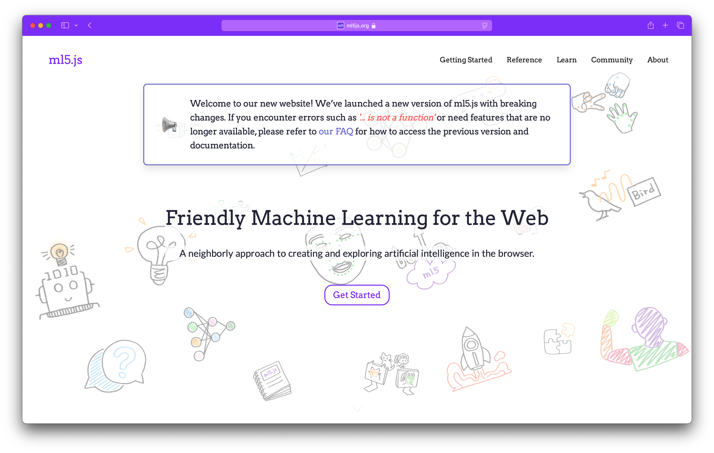
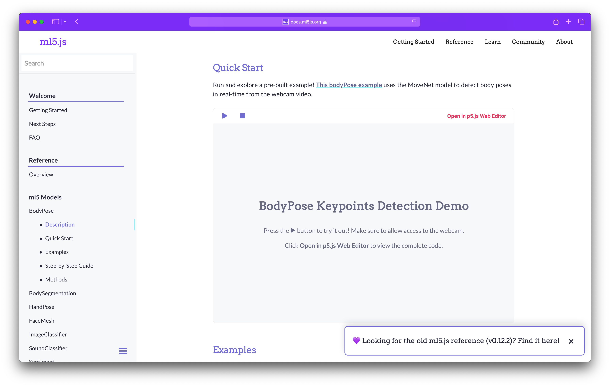

Website development and pedagogical development for ml5.js, an open-source JavaScript machine-learning library. The ongoing work includes the website, beginner-facing documentation, example sketches, and API contributions.

The website work brings documentation and interactive learning materials together with the library’s development.

[ml5.js website](https://ml5js.org/) · [Development team](https://ml5js.org/about/)
