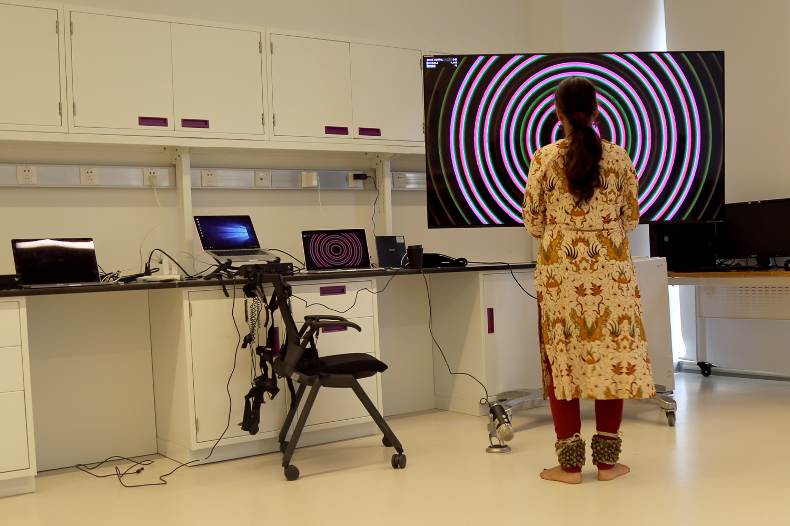
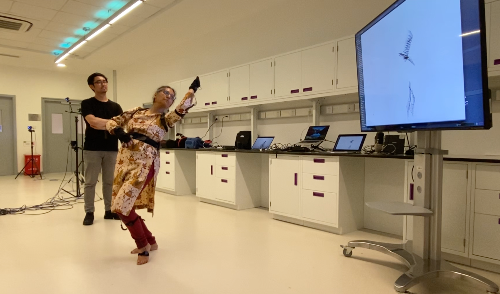
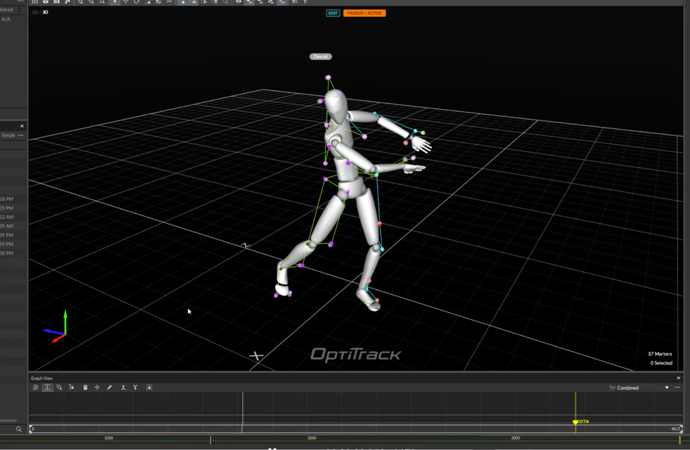
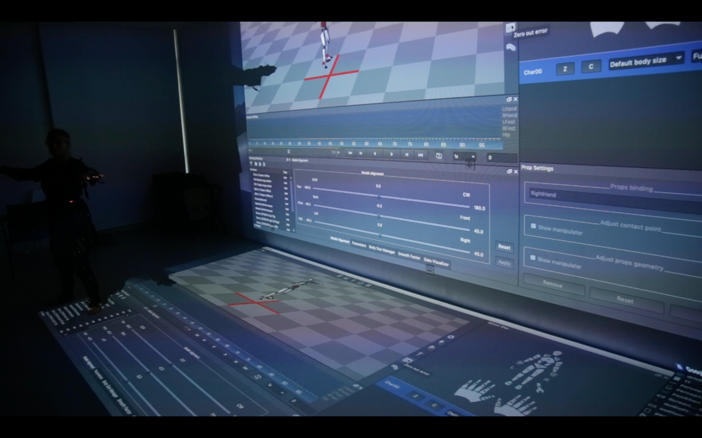
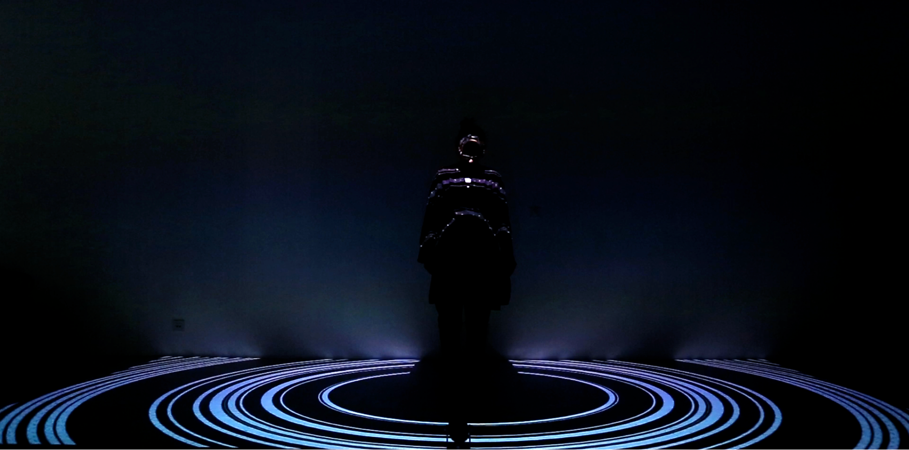

<iframe width="560" height="315" src="https://www.youtube.com/embed/hRj4mMm5CDo" frameborder="0" allow="accelerometer; autoplay; encrypted-media; gyroscope; picture-in-picture" allowfullscreen></iframe>

- Collaboration with Deepti Gupta, a traditional Indian dance choreographer.
- Integrated motion capture tools:
  - [PoseNet](https://medium.com/tensorflow/real-time-human-pose-estimation-in-the-browser-with-tensorflow-js-7dd0bc881cd5)
  - [KinectV2](https://medium.com/@lisajamhoury/understanding-kinect-v2-joints-and-coordinate-system-4f4b90b9df16)
  - [Perception Neuron](https://neuronmocap.com/)
  - [OptiTrack](https://optitrack.com/)
- Developed audio visualization tools for dance improvisation.
- Explored the intersection of traditional Kathak dance and technology.

