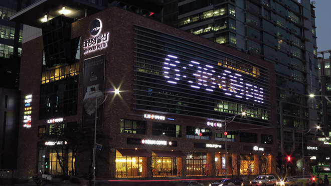
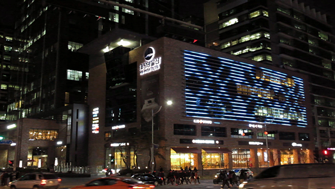
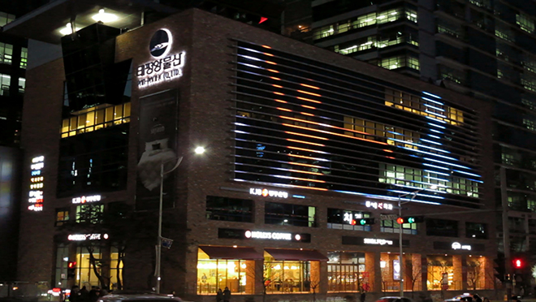
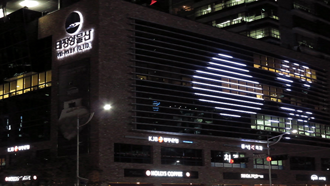
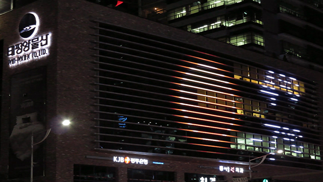
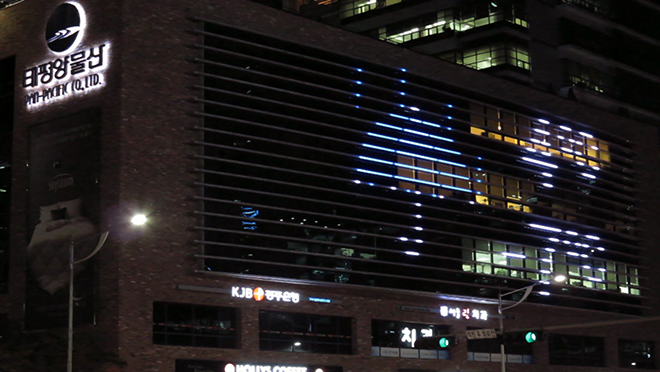
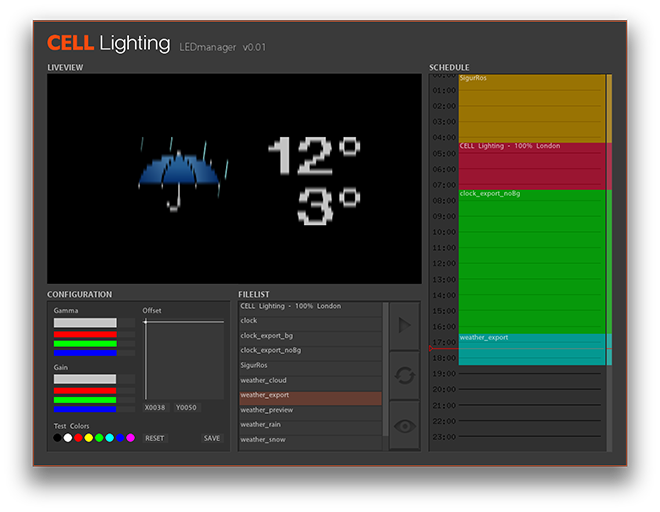

Work for the PanPacific building in Seoul included LED media content, an LED manager, and weather and clock content using RSS feeds, recorded in April 2013.

The photographs document the exterior LED display.

