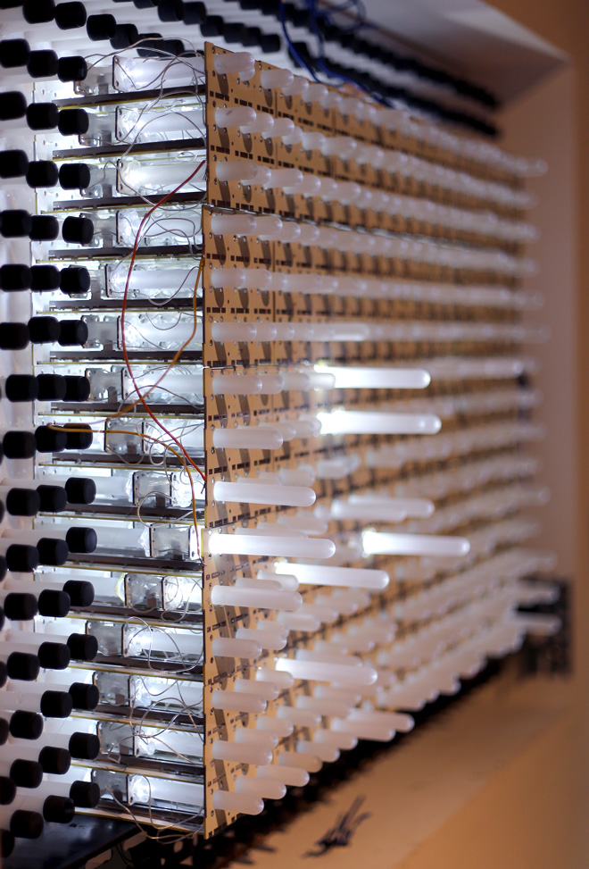
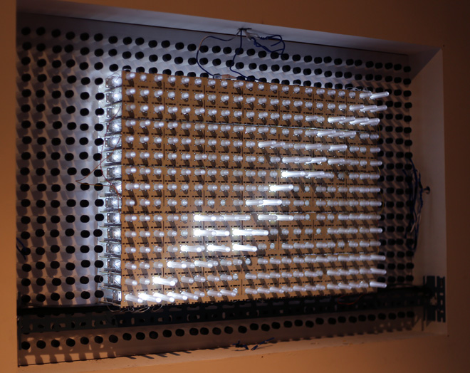
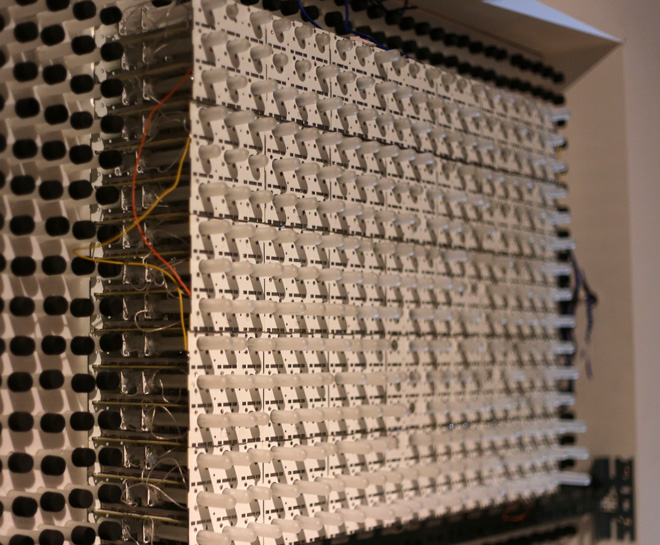
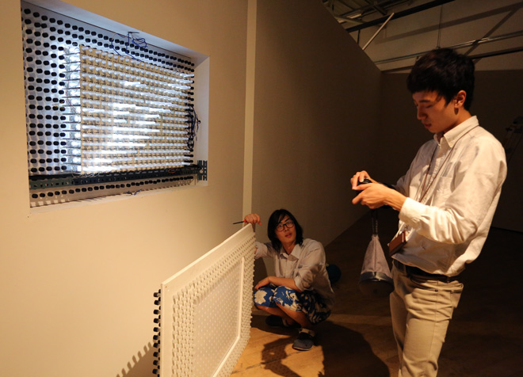

Prototype research into small LED modules, wireless power transmission, and a custom potentiometer. The surviving notes document coil dimensions, a 555-timer resonance circuit, and tests aimed at separating the lighting modules from their base.

Further documentation pending.

<iframe width="1120" height="630" src="https://www.youtube.com/embed/425nFSNIDqw" title="Pinlight — archived video 1" loading="lazy" allow="autoplay; fullscreen; picture-in-picture" allowfullscreen></iframe>

<iframe width="1120" height="630" src="https://player.vimeo.com/video/63996227" title="Pinlight — archived video 2" loading="lazy" allow="autoplay; fullscreen; picture-in-picture" allowfullscreen></iframe>

<iframe width="1120" height="630" src="https://player.vimeo.com/video/63996379" title="Pinlight — archived video 3" loading="lazy" allow="autoplay; fullscreen; picture-in-picture" allowfullscreen></iframe>

