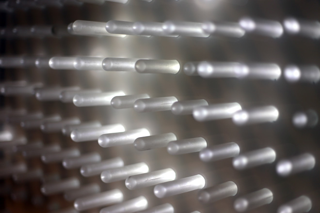
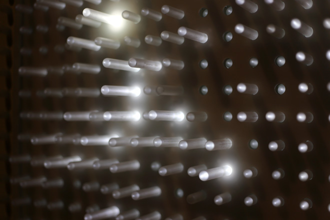
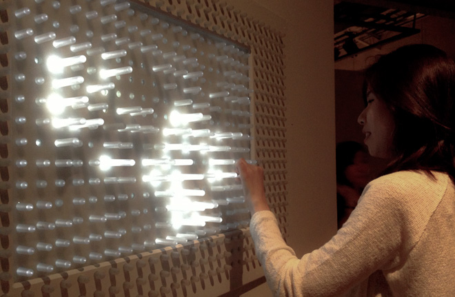
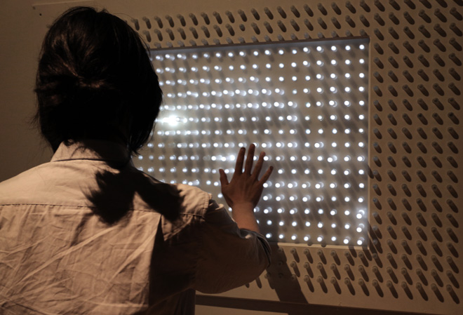
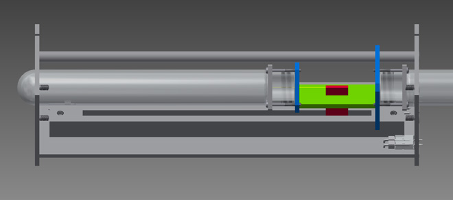
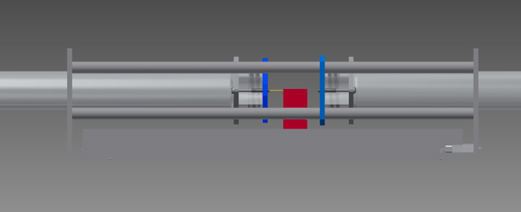
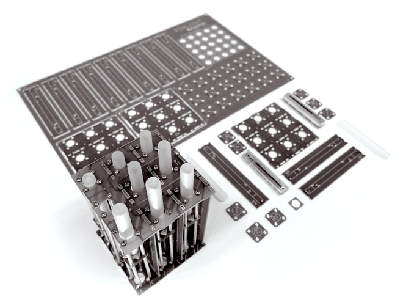
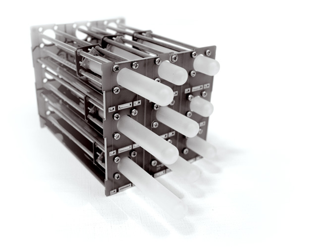
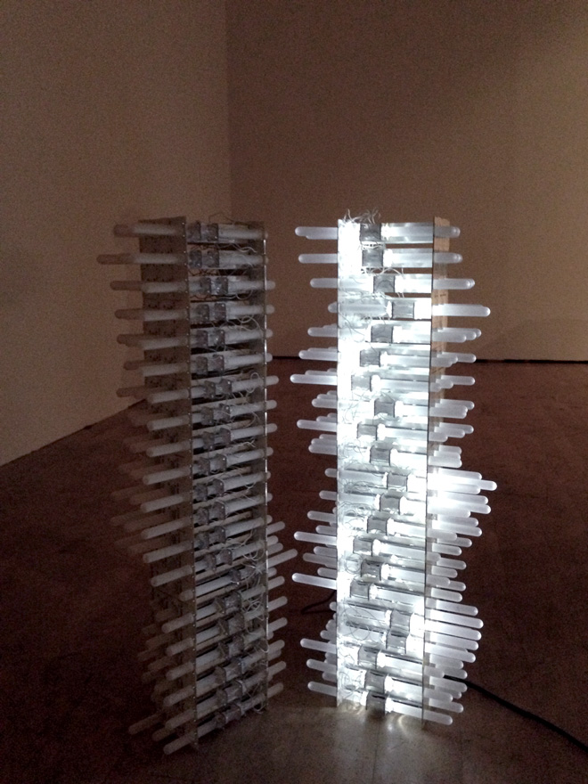
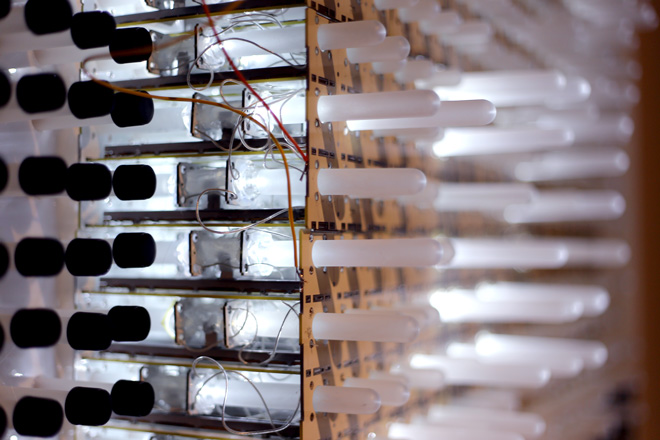

Prototype research into small LED modules, wireless power transmission, and a custom potentiometer. The surviving notes document coil dimensions, a 555-timer resonance circuit, and tests aimed at separating the lighting modules from their base.

Further documentation pending.

