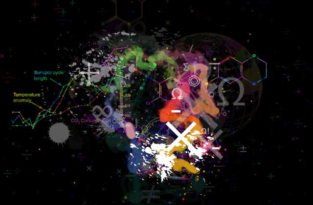
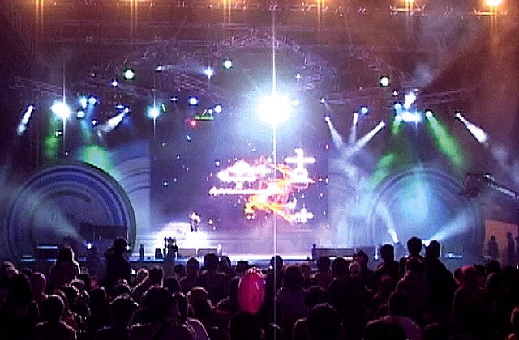
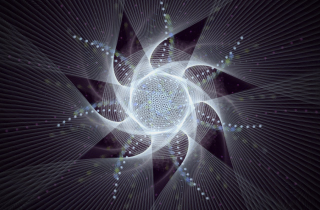
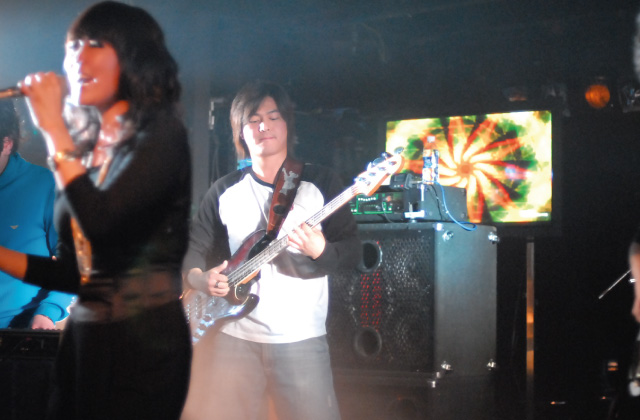
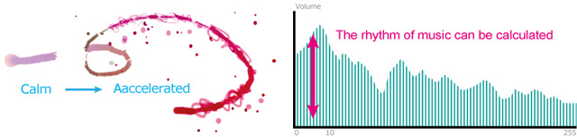
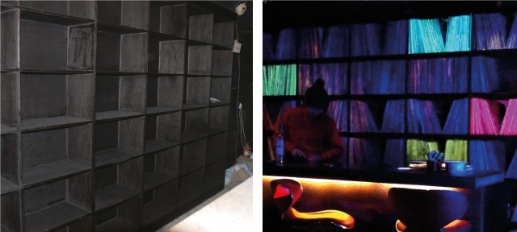
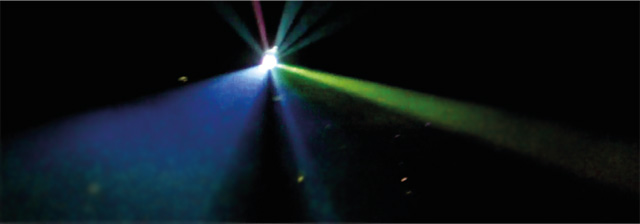
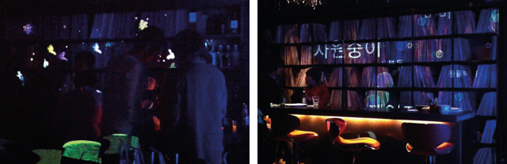
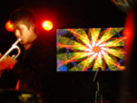
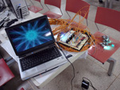

A series of sound-responsive visual works developed with Processing and Flash AS3 for projection, PDP screens, and LED displays. The systems use sound volume, changes in volume, and rhythm as visual inputs.

Presentations included V+S Mandala at Soundholic (2007), Number We Think at Hangaram Art Museum (2009), the Science Family Festival (2010), and 100% Design London (2010). The archive also includes Sori Paint and the 2011 performance Fragrance.

- [Video 1](https://vimeo.com/34355843)
- [Video 2](https://vimeo.com/34356141)
