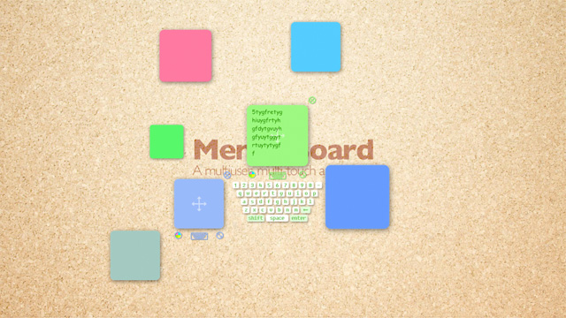
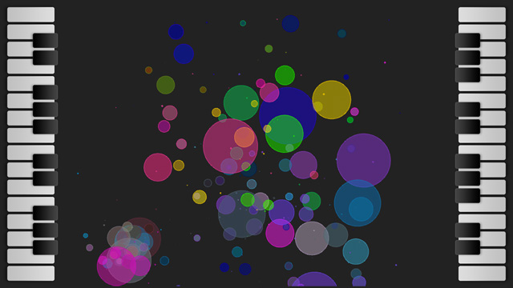
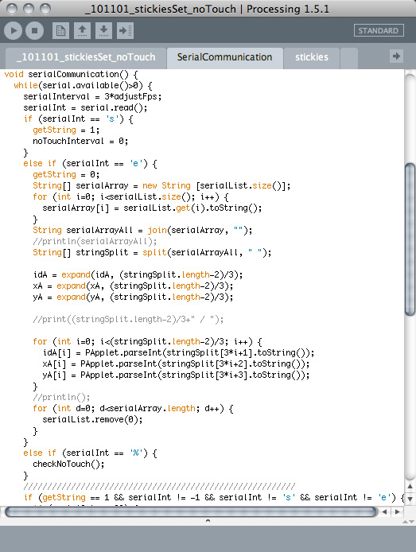
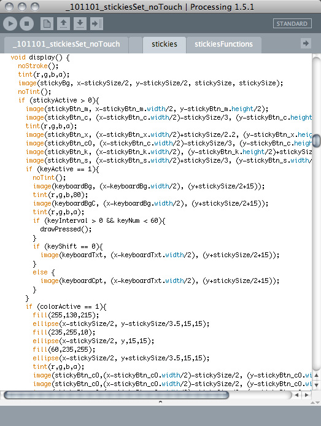
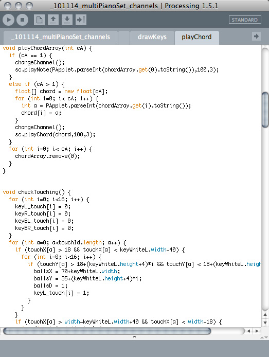

Two applications demonstrate a multi-touch system using an interior wall for Stickies and a table for Piano. Work included graphic design and Processing programming with serial communication.

The Piano application uses the SoundCipher library to play chords from simultaneous touches.

<iframe width="1120" height="630" src="https://player.vimeo.com/video/35381291" title="Stickies &amp; Piano — Video" loading="lazy" allow="accelerometer; autoplay; clipboard-write; encrypted-media; gyroscope; picture-in-picture; fullscreen" allowfullscreen></iframe>
