Technical coordination for the opening digital performance of the 60th International Astronautical Congress. The production included a six-meter Digital HonCheonUi sculpture, 16 robotic percussion instruments, and wearable LED devices.

Work included leading 14 student volunteers, installing and programming robotic percussion with Processing, and programming four lighting patterns for Arduino-based wearable devices.

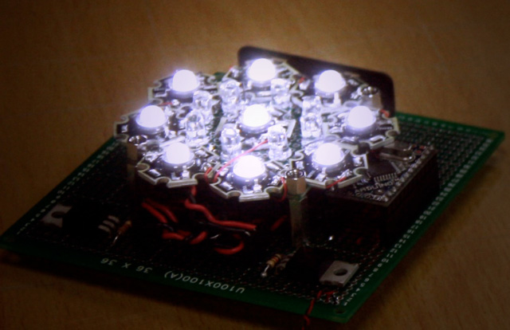

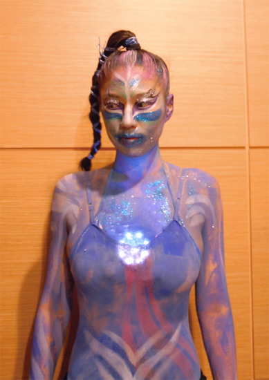

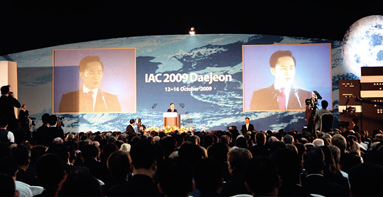

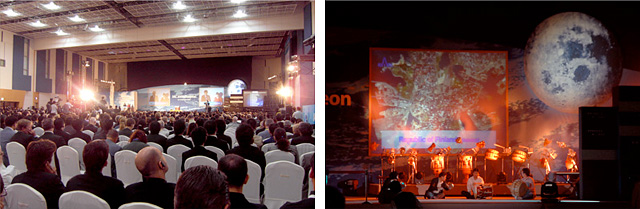

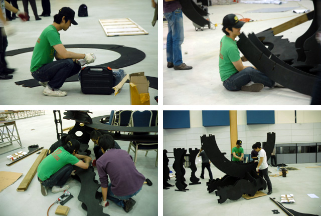

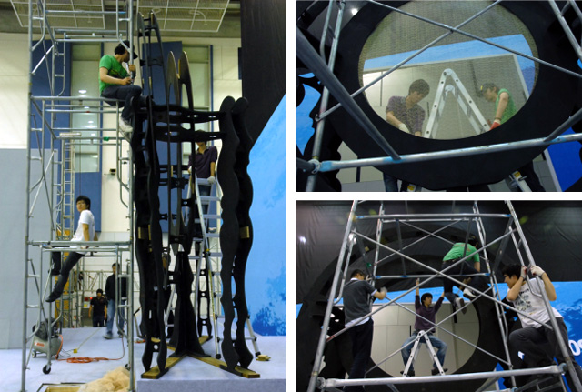

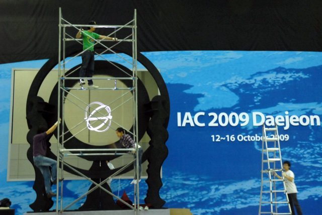

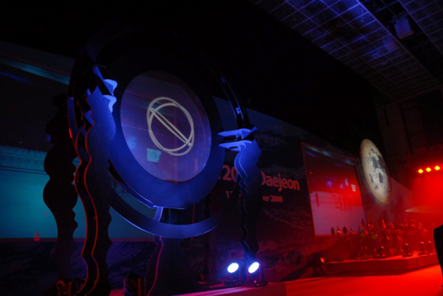

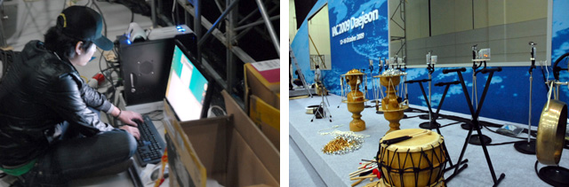

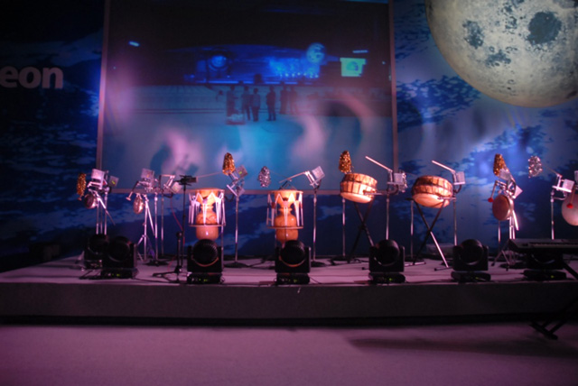

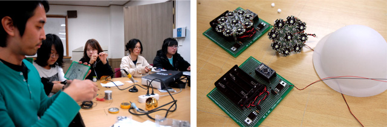

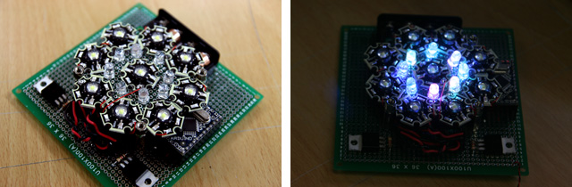

<iframe width="1120" height="630" src="https://player.vimeo.com/video/8205678" title="The Feast of Space — IAC 2009 — Video" loading="lazy" allow="accelerometer; autoplay; clipboard-write; encrypted-media; gyroscope; picture-in-picture; fullscreen" allowfullscreen></iframe>
