A mirror installation responds to the direction and volume of sound. Microphones provide input to a system that controls servo motors, turning the mirrors toward sounds in the room.

The installation uses acrylic mirrors, an aluminum frame, Arduino-controlled motors, and sound processing. It was shown at HCI Korea and Hongik Art Hall in 2008, followed by exhibitions including Seogyo Sixty and Seogyo Nanjang in 2009.

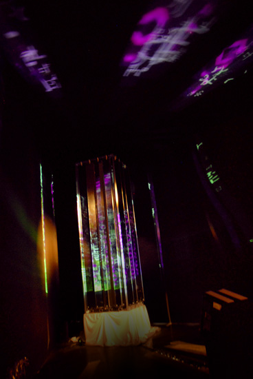

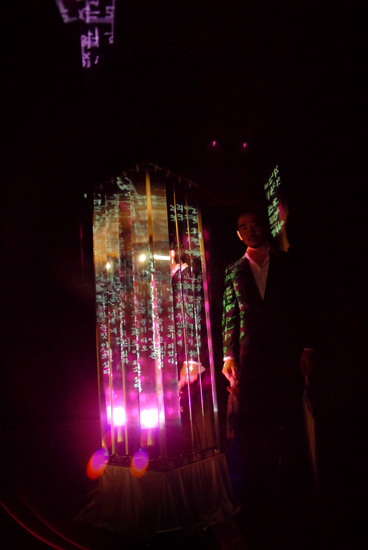

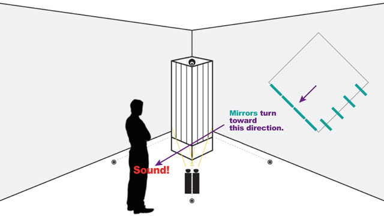

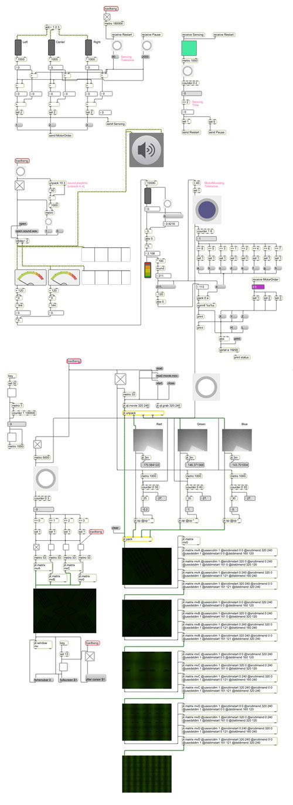

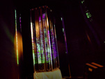

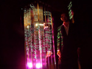

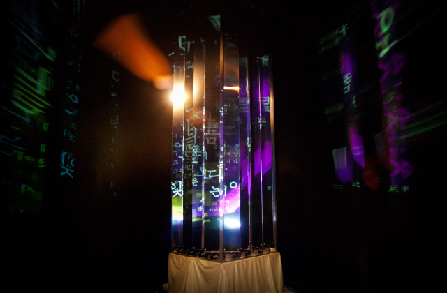

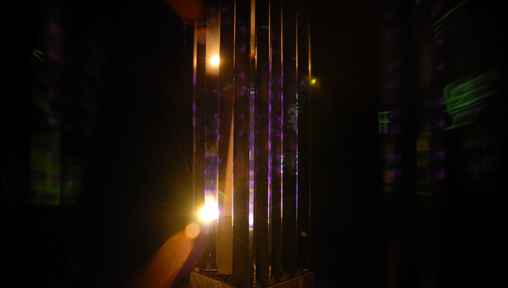

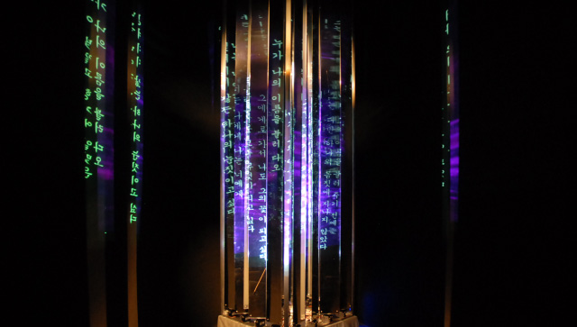

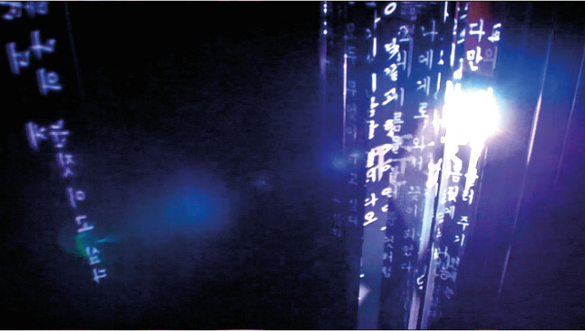

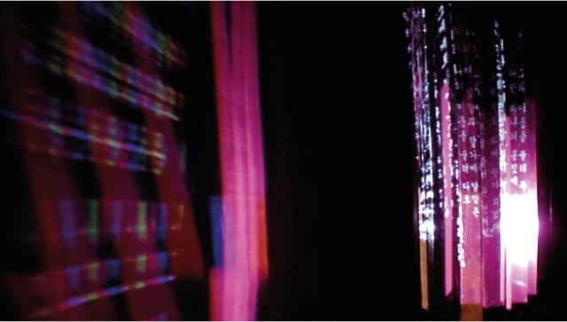

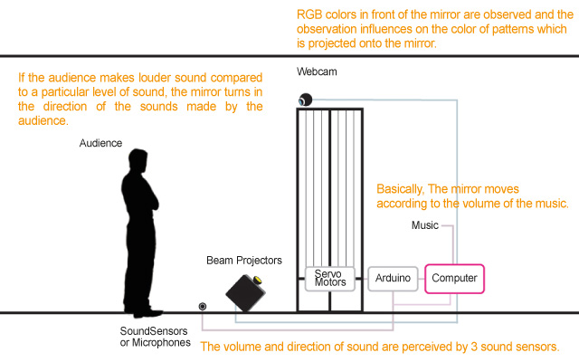

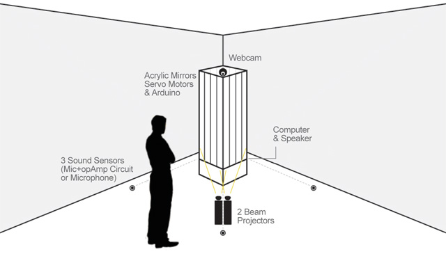

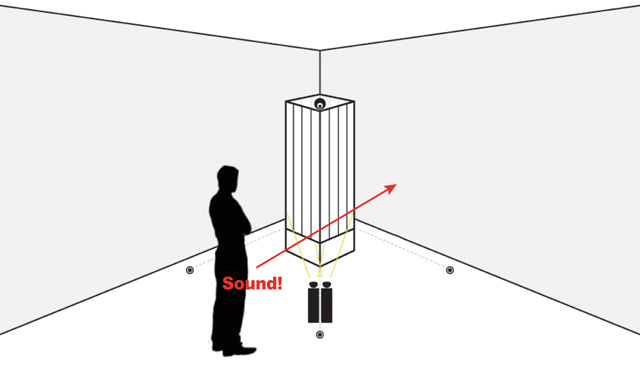

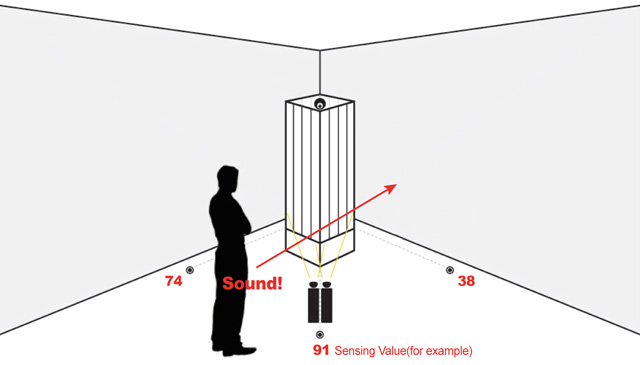

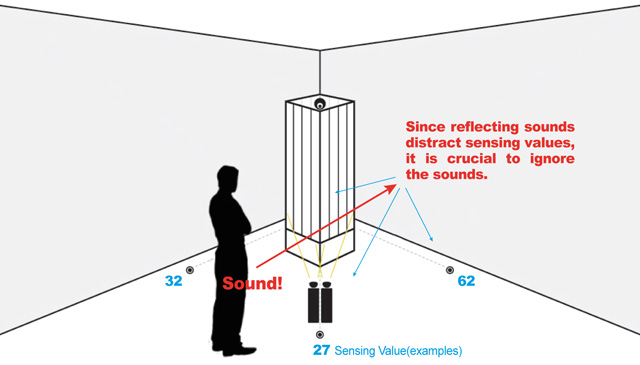

<iframe width="1120" height="630" src="https://player.vimeo.com/video/34356406" title="The Listening Mirror — Video" loading="lazy" allow="accelerometer; autoplay; clipboard-write; encrypted-media; gyroscope; picture-in-picture; fullscreen" allowfullscreen></iframe>
