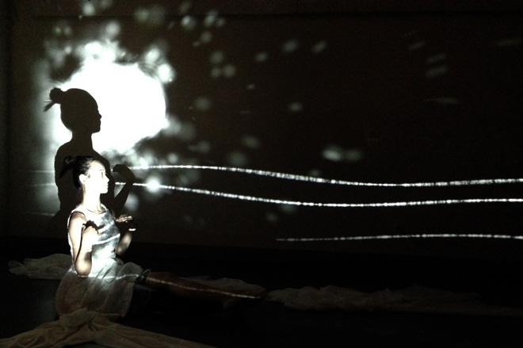

A dance performance uses interactive sound and video to explore the changing character of water. The dancer’s movements affect the surrounding media as the performance moves from calm to playful and violent states.

The work draws on the proverb that the water carrying a boat can also overturn it.

<iframe width="1120" height="630" src="https://www.youtube.com/embed/5imT-TdKZQc" title="The Nature of Water — archived video 1" loading="lazy" allow="autoplay; fullscreen; picture-in-picture" allowfullscreen></iframe>

