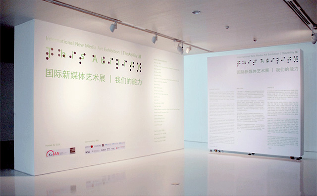
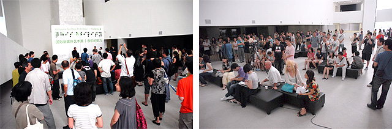
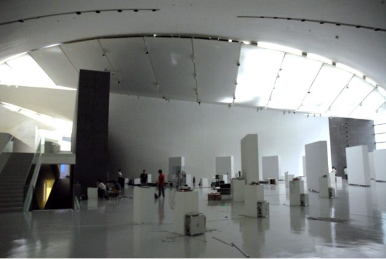
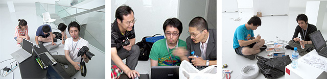
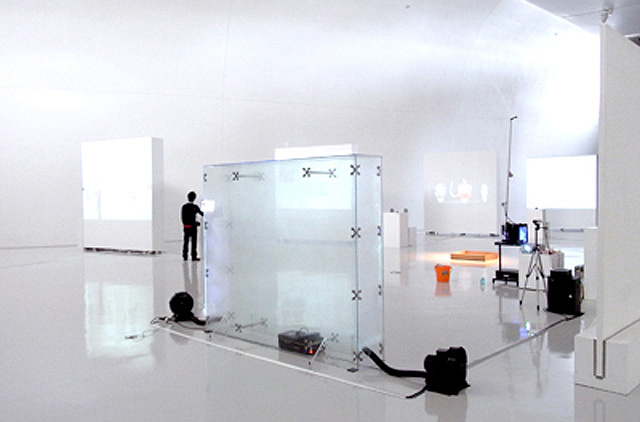
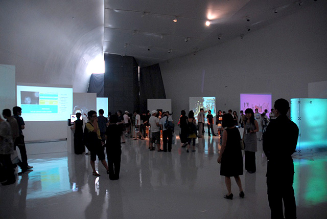

Technical coordination for an international new-media exhibition at CAFA Art Museum. Work included assisting 20 artists with installation, electrical wiring, arranging works, and graphic design for banners and the guidebook.

