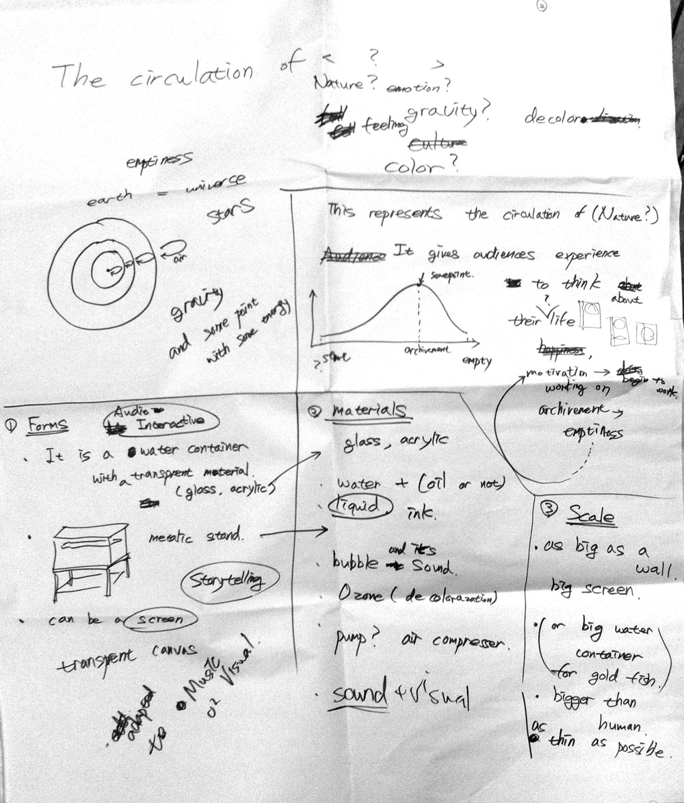
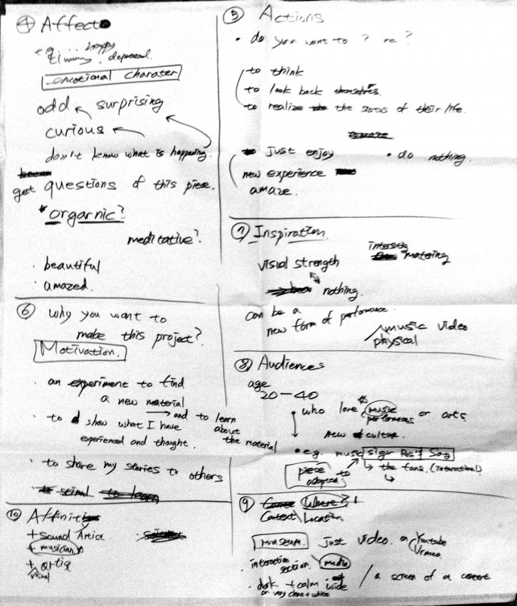
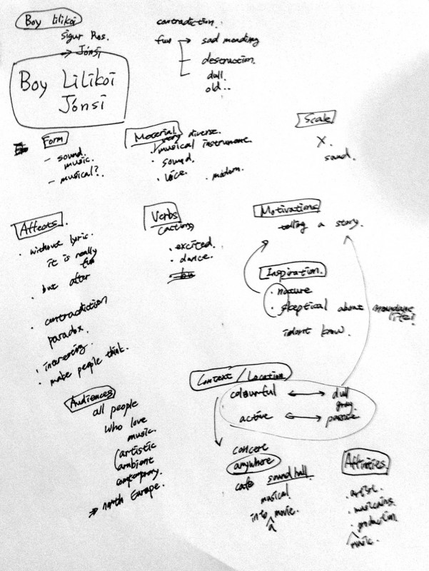

Void was presented at the ITP Spring Show on May 19, 2014. The CV also records filming for an Intel advertisement in May 2014.

An installation study investigates cycles of color and transparency using ink, water, and ozone. Ink disperses in water, while ozone is explored as a means of removing its color so that the cycle can repeat.

The archive records ink movement tests, bubbles, an ozone generator, and proposals for sound-responsive control. Sori-ink and Ink Test are retained as development material for this work rather than listed as separate completed installations.

<iframe width="1120" height="630" src="https://player.vimeo.com/video/92940927" title="Void / Sori-ink — Video 1" loading="lazy" allow="accelerometer; autoplay; clipboard-write; encrypted-media; gyroscope; picture-in-picture; fullscreen" allowfullscreen></iframe>

<iframe width="1120" height="630" src="https://player.vimeo.com/video/87161641" title="Void / Sori-ink — Video 2" loading="lazy" allow="accelerometer; autoplay; clipboard-write; encrypted-media; gyroscope; picture-in-picture; fullscreen" allowfullscreen></iframe>

<iframe width="1120" height="630" src="https://player.vimeo.com/video/86042376" title="Void / Sori-ink — Video 3" loading="lazy" allow="accelerometer; autoplay; clipboard-write; encrypted-media; gyroscope; picture-in-picture; fullscreen" allowfullscreen></iframe>

<iframe width="1120" height="630" src="https://player.vimeo.com/video/121526530" title="void — archived video" loading="lazy" allow="autoplay; fullscreen; picture-in-picture" allowfullscreen></iframe>
