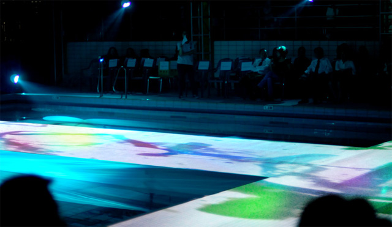
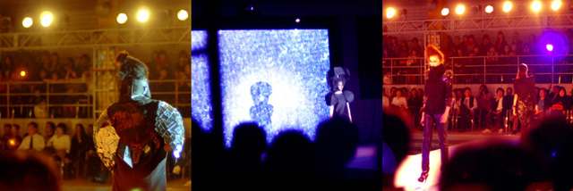
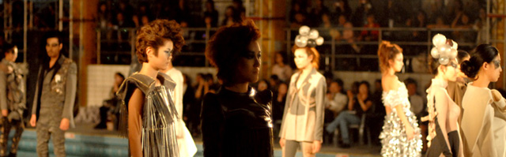

Planning and programming for the finale of Wearing Sound, a fashion show staged on a swimming-pool runway. A version of Sori Paint was adapted to produce projected color that followed a model. Processing and a beam projector were used.

<iframe width="1120" height="630" src="https://player.vimeo.com/video/35369942" title="Wearing Sound — Fashion Show Finale — Video" loading="lazy" allow="accelerometer; autoplay; clipboard-write; encrypted-media; gyroscope; picture-in-picture; fullscreen" allowfullscreen></iframe>
