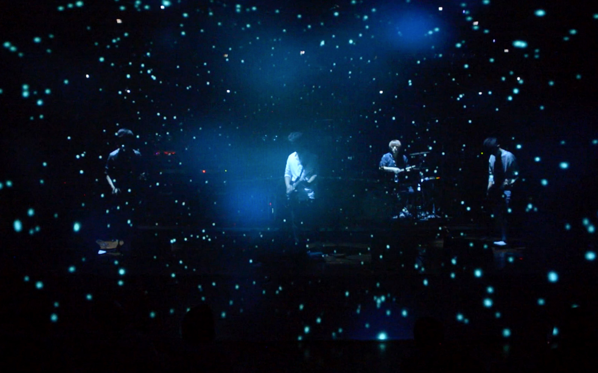
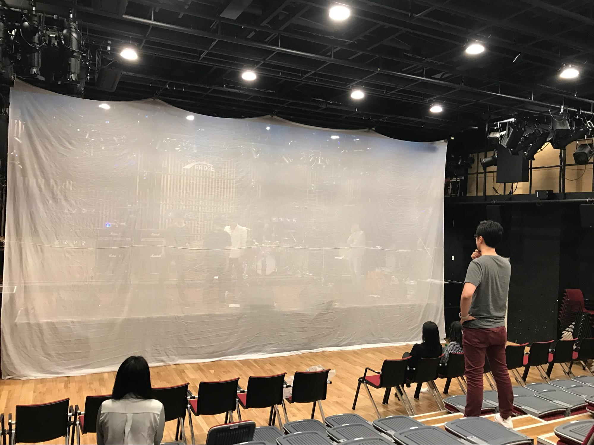
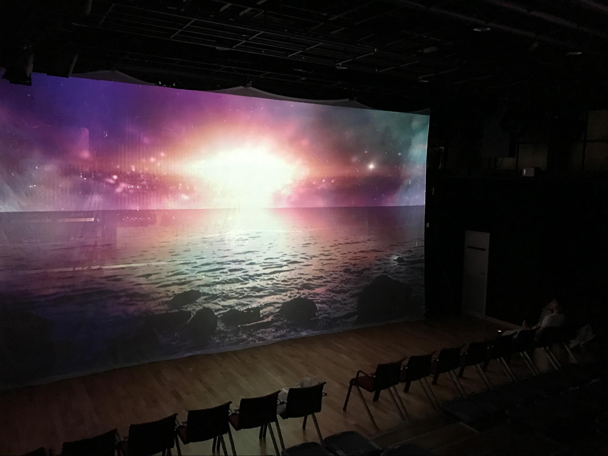
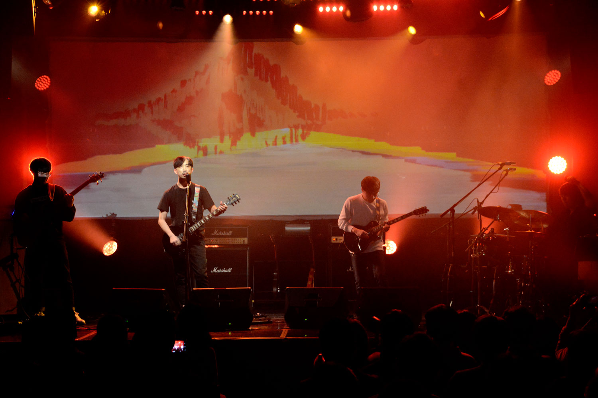
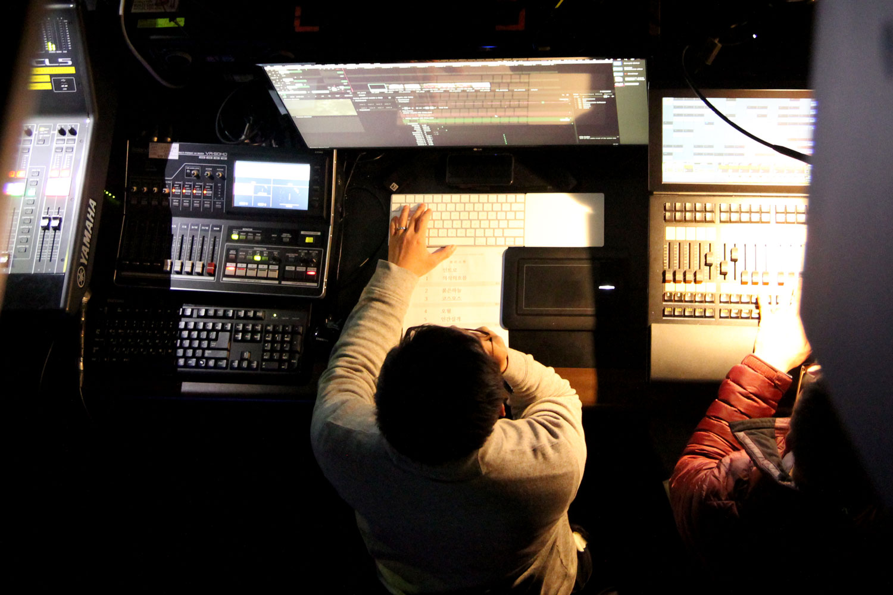
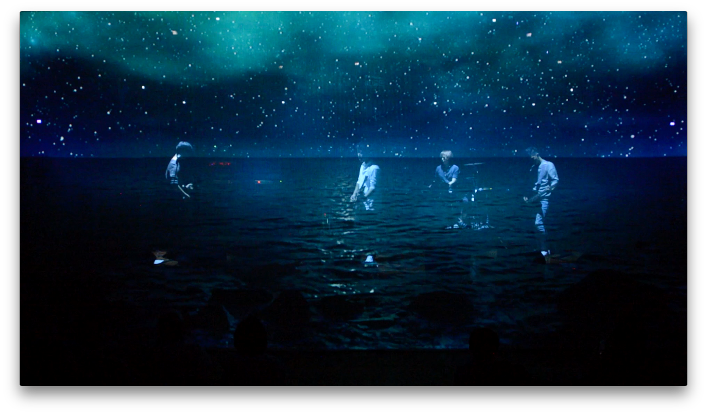
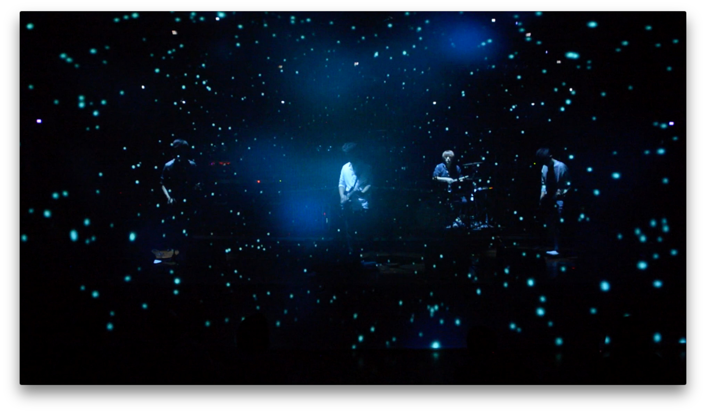
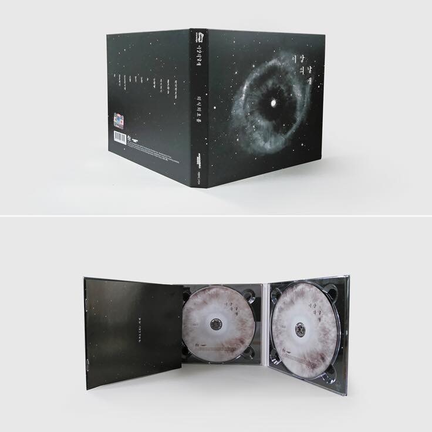
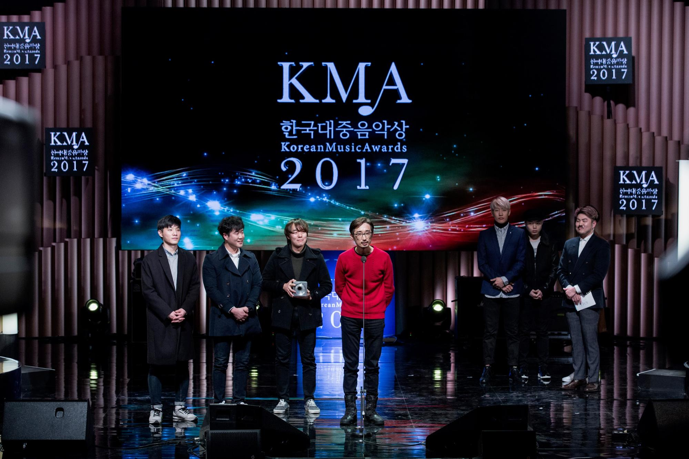

<iframe width="1120" height="630" src="https://www.youtube.com/embed/EWHcW4i7lKY" title="Wings of the Isang&#x27;s New Media Performance — archived video 1" loading="lazy" allow="autoplay; fullscreen; picture-in-picture" allowfullscreen></iframe>

<iframe width="1120" height="630" src="https://www.youtube.com/embed/xglnhOfC3Fw" title="Wings of the Isang&#x27;s New Media Performance — archived video 2" loading="lazy" allow="autoplay; fullscreen; picture-in-picture" allowfullscreen></iframe>

<iframe width="1120" height="630" src="https://www.youtube.com/embed/dcOQKDCJrnk" title="Wings of the Isang&#x27;s New Media Performance — archived video 3" loading="lazy" allow="autoplay; fullscreen; picture-in-picture" allowfullscreen></iframe>

<iframe width="1120" height="630" src="https://www.youtube.com/embed/xb1afM46Vbs" title="Wings of the Isang&#x27;s New Media Performance — archived video 4" loading="lazy" allow="autoplay; fullscreen; picture-in-picture" allowfullscreen></iframe>

Interactive media and live visuals for concerts by Wings of the Isang. The work combined prepared video, real-time graphics, and stage media control. Responsibilities included art direction, visual art and creative coding, and intermedia operation.

Visual systems included Void Circle, performed live with custom software. Concert records include the 2016 and 2017 showcases and In a Moment and Eternity in 2019.

## Related Videos

<iframe width="1120" height="630" src="https://www.youtube.com/embed/videoseries?list=PLSIzOgCcEvNzFkMc9a-m146XACwsFxIuA" title="Wings of the Isang&#x27;s New Media Performance — &quot;In a Moment and Eternity&quot;" loading="lazy" allow="accelerometer; autoplay; clipboard-write; encrypted-media; gyroscope; picture-in-picture; fullscreen" allowfullscreen></iframe>

<iframe width="1120" height="630" src="https://www.youtube.com/embed/videoseries?list=PLSIzOgCcEvNwW_z5NVbH_PdxsjCIJzz4d" title="Wings of the Isang&#x27;s New Media Performance — &quot;Stream of Consciousness&quot;" loading="lazy" allow="accelerometer; autoplay; clipboard-write; encrypted-media; gyroscope; picture-in-picture; fullscreen" allowfullscreen></iframe>

The interactive visuals and lighting effects were controlled in real-time.

## 14th Korean Music Awards 2017

**Award**: Best Modern Rock Album Winner - _Stream of Consciousness_ by Wings of the Isang

Collaboration with Wings of the Isang since 2013 has included performances, music videos, album covers, and graphic design.

  

